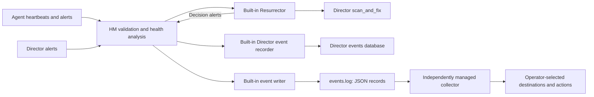

# Meta
[meta]: #meta
- Name: Replace Health Monitor plugins with a structured event log
- Start Date: 2026-10-29
- Author(s): @aramprice
- Status: Draft
- RFC Pull Request: [community#1671](https://github.com/cloudfoundry/community/pull/1671)
- Related RFCs: [Support Platform Logs Collection and Processing with OpenTelemetry](https://github.com/cloudfoundry/community/pull/1624)
- Affected Component(s): BOSH Health Monitor, bosh-release, bosh-deployment, BOSH documentation, syslog-release, bosh-system-metrics-server-release, bosh-hm-forwarder-release

## Summary

Deprecate the BOSH Health Monitor (HM) plugin architecture and replace external notification plugins with one supported output: a dedicated, versioned, newline-delimited JSON event log. HM writes events; independently managed collectors read them and handle forwarding, filtering, notification, and other actions.

Move the Resurrector into HM as a built-in component, retaining its configuration switches and existing safeguards. Also preserve recording HM alerts in the Director event database as fixed internal functionality, so operators retain those records through `bosh events`.

Remove both Ruby plugin dispatch and the JSON plugin's executable discovery and process management. HM will neither load integration plugins nor launch consumer programs. Removing arbitrary executable discovery also allows removing `/var/vcap/jobs` from HM's BPM configuration, significantly tightening the job's sandbox. The replacement must be operational and have a documented migration path before the existing interfaces are removed.

## Problem

HM combines core BOSH health management with destination-specific integrations. Sending email, managing PagerDuty incidents, translating metrics for Graphite or OpenTSDB, and maintaining Consul checks require different dependencies, credentials, configuration, and failure handling. These responsibilities increase maintenance and complexity without being necessary for BOSH to detect unhealthy instances or request their recovery.

The current JSON plugin already separates event serialization from destination-specific processing, but HM still discovers, starts, and manages arbitrary executables. Moving all integrations behind that plugin would retain the process-lifecycle coupling this proposal seeks to remove.

Operators need the same health information through a smaller, consistent interface. They should be able to choose collection and notification systems without changing HM or adding code that it invokes. This proposal does not depend on proving that any particular integration has no remaining users.

### Current behavior and ecosystem

This proposal is language-agnostic and applies equally to the Ruby implementation and to the Go implementation of HM that is under development. Class and file names below describe the Ruby baseline at [`979e3032`][bosh-baseline] and are illustrative.

HM receives agent heartbeats and alerts over NATS, enriches them with deployment and instance information, generates additional alerts from its health analysis, and receives Director alerts. The event processor validates events and suppresses repeated IDs per event kind using an in-memory cache. The plugin event kinds are `alert` and `heartbeat` ([processor][processor], [instances][instances]).

| Current mechanism | Responsibility | Proposed disposition |
| --- | --- | --- |
| Email, PagerDuty | External alert notification | Independent consumers of the event log |
| Graphite, OpenTSDB | Heartbeat metric forwarding | Independent consumers of the event log |
| Datadog, Riemann | Alert and metric forwarding | Independent consumers of the event log |
| Consul Event Forwarder | Events and heartbeat-derived TTL checks | Independent consumer; check management remains external |
| JSON plugin | Writes JSON to discovered child processes over stdin | Replace with the event log; remove discovery and child management |
| Logger plugin | Human-readable alert logging | Ordinary built-in diagnostic logging |
| Event Logger plugin | Posts alert records to the Director's `/events` API | Built-in Director event recording |
| Resurrector plugin | Requests Director recovery of affected instances | Built-in resurrection component |

The [job template][hm-template] always configures Logger, Event Logger, and JSON; optional properties enable the other plugins and the Resurrector. The JSON plugin separately discovers `/var/vcap/jobs/*/bin/bosh-monitor/*`, and the [HM BPM configuration][hm-bpm] grants execution access to those hooks. Both extension mechanisms are in scope.

HM provides no common durable outgoing queue, delivery acknowledgment, or replay. Deduplication state is in memory, the email plugin removes batched records before attempting delivery, and the TCP and HTTP helpers drop or log failed sends without durable retry. Best-effort external delivery is therefore consistent with the existing framework. Director events, once recorded, are persisted separately, and this proposal preserves that.

Known consumers, from a source-based inventory rather than a census of installations:

- [`bosh-deployment`](https://github.com/cloudfoundry/bosh-deployment) ships Datadog and Graphite ops files under [`hm/`][hm-ops] and a [syslog ops file][syslog-ops] that colocates `syslog_forwarder` with the Director.
- [`syslog-release`][syslog-spec] tails job logs with [Blackbox][blackbox]. Its local transport and message-size settings affect complete JSON records, and Blackbox assigns a fixed syslog priority.
- The deprecated [BOSH System Metrics Server][metrics-server] consumes the JSON plugin's stdin interface, and its [forwarder][metrics-forwarder] sends heartbeats to Loggregator. The older [BOSH HM Forwarder][hm-forwarder] depends on HM's OpenTSDB output.
- [BOSH Exporter][bosh-exporter] exposes Director metrics but does not replace the HM alert stream.
- The platform logs OpenTelemetry RFC proposes independent collection of BOSH job logs. It is a draft, not an assumed capability. The [filelog receiver][filelog] already supports JSON parsing and rotation.

Maintainers must solicit additional consumers during the deprecation period.

## Proposal

### Responsibility boundary

HM retains agent monitoring, health analysis, resurrection decisions, diagnostic logging, and Director event recording, and gains one fixed event-log writer. External systems own collection, routing, aggregation, vendor credentials, notifications, dashboards, and any additional automated actions.



The arrows to internal components are fixed application wiring, not a configurable subscriber registry. Resurrection and Director event recording do not read the file or depend on a collector. Only deployment-health alerts enter resurrection decision handling; resulting decision alerts MUST NOT create a resurrection loop.

### One event log

HM writes `/var/vcap/sys/log/health_monitor/events.log` whenever it is running. The stream contains every validated, deduplicated alert and heartbeat that would have reached the current plugin dispatcher. Existing enrichment, heartbeat eligibility, health-analysis rules, and deduplication remain unchanged.

The file contains UTF-8 JSON, one complete object followed by a newline per record, with no logging prefix. Operational messages remain in `health_monitor.log`; `hm.loglevel` does not filter the event stream. There is no destination selector, executable path, template callback, configurable serializer, or event-type filter. Any filter, for example to emit only alerts, would be a separate follow-up that does not alter the schema.

Multiple local readers can consume the file independently. Remote consumers use an independently deployed collector to forward it over syslog, OTLP, or another transport. HM has no knowledge of those destinations and does not supervise the collector.

### Event contract

Each record MUST have a `schema_version`, an `emitted_at` timestamp, and an `event` object. Version 1 preserves existing event field names, values, timestamps, metric names, and units. Consumers MUST tolerate additional fields; changing existing field meanings or types requires a new schema version and a migration plan.

`emitted_at` is an RFC 3339 UTC timestamp with microsecond resolution recording when HM serialized the record, so log indexers can order events that share the same integer-second producer timestamp.

| Event kind | Required preservation |
| --- | --- |
| `alert` | `kind`, `id`, numeric `severity`, `category`, `title`, `summary`, `source`, `deployment`, `created_at`; also the structured `job`, `instance_id`, and `jobs_to_instance_ids` attributes when present |
| `heartbeat` | `kind`, `id`, `timestamp`, `deployment`, `agent_id`, `job`, `index`, `instance_id`, `job_state`, `vitals`, `teams`, `metrics`, and optional `number_of_processes` |

The existing [alert serializer][alert-model] omits attributes available to plugins, notably instance identity and the affected-instance map used by resurrection, so redirecting today's serialized output would lose them. The `event` object therefore combines the serialized attributes with the full internal attribute set, with the internal values taking precedence. Only event data is exported, never arbitrary objects, credentials, or HM configuration.

Numeric severity remains BOSH severity, not syslog priority. Timestamps retain Unix seconds, including the existing distinction between alert `created_at` and heartbeat `timestamp`. Metric values keep their current string representation, and existing nulls and optional fields are preserved. This RFC adds no new health conditions, renames no metrics, and does not add Director audit events beyond the Director alerts HM already receives.

Illustrative alert, formatted across lines for readability; the actual record occupies one line:

```json
{
  "schema_version": 1,
  "emitted_at": "2026-10-29T21:45:00.123456Z",
  "event": {
    "kind": "alert",
    "id": "dd291557-a181-40bb-94ce-0e08f31a58e7",
    "severity": 2,
    "category": "deployment_health",
    "title": "example has instances with timed out agents",
    "summary": "example has instances with timed out agents",
    "source": "example",
    "deployment": "example",
    "created_at": 1793232000,
    "jobs_to_instance_ids": {"worker": ["instance-1"]}
  }
}
```

Collectors SHOULD attach a stable Director/environment identity before combining streams. Event IDs are preserved but are not a globally unique delivery identifier or an incident identity: repeated conditions can generate fresh IDs, and some producers reuse IDs. Consumers MUST tolerate duplicates and MUST NOT infer recovery from the absence of another alert.

### Failure behavior and file lifecycle

External delivery remains best effort. HM does not wait for reader acknowledgment, keep per-consumer offsets, or provide replay. Retained files can permit collector catch-up but do not establish durable delivery across rotation, disk failure, or Director VM replacement.

- The writer MUST use a bounded queue and an independent worker so event handling never waits for filesystem I/O. A full queue drops records and increments a drop counter.
- Write failures MUST be contained, reported with rate-limited diagnostics and operational counters, and MUST NOT block resurrection decisions or Director event recording. Diagnostics MUST NOT enqueue an alert into a failing writer.
- A single writer serializes records without interleaving. It appends with `O_APPEND` to remain compatible with stemcell log rotation, and after an interrupted write MUST restore a record boundary before appending. Readers discard incomplete or malformed records. Restart and rotation behavior MUST be tested with the supported stemcell logging configuration.
- Oversized records MUST be rejected whole with an observable error, never truncated into invalid JSON. Collector limits MUST accommodate the supported record size.
- Queue capacity, record-size limit, retention, and rotation thresholds MUST be justified by measurements, including large deployment-health alerts, before release. Rotation MUST bound disk usage and avoid competing rotation rules. The release introducing the event log MUST ship a default retained-disk budget derived from those measurements and state it in its release notes.
- The log exposes health information from multiple deployments. Grant read access to authorized collectors and account for file permissions, BPM mounts, and AppArmor. Alert summaries can contain error details, so diagnostic-text exposure should be reviewed when publishing the schema.

### Independent collection

The initial migration documentation MUST include a tested syslog collection example using existing BOSH deployment patterns. It MUST colocate and independently supervise the collector on the HM VM (including `create-env` Directors), identify the event file separately from diagnostic logs, parse the JSON payload, and attach Director identity. When using Blackbox it MUST set `syslog.use_tcp_for_file_forwarding_local_transport: true` and size `syslog.max_message_size` for the supported record size, because the job warns about UDP truncation above 1 KB and defaults the rsyslog maximum to 8 KB. It MUST demonstrate rotation, collector restart, a disconnected destination, and oversized records, and document offsets, retention, possible duplicates or loss, and secure remote forwarding.

An OpenTelemetry filelog example MAY be supplied. It MUST pin the collector version and verify JSON parsing, truncation handling, and maximum record size. It adds no OTLP client to HM and does not make acceptance of the platform logs RFC a prerequisite.

### Built-in resurrection

Move the Resurrector and its alert-tracking helper out of the plugin namespace and instantiate them explicitly as HM components. The existing decision algorithm and Director interaction are preserved: HM requests `/deployments/:deployment/scan_and_fix` and the Director performs recovery. Director API calls MUST run asynchronously, without blocking the event processor or event-log writer. ([resurrector][resurrector], [alert tracker][resurrector-helper])

Preserve:

- `hm.resurrector_enabled` and its release-job default of `false`; the standard `bosh-deployment` manifest sets it to `true`, and that is unchanged.
- `hm.resurrector.minimum_down_jobs`, `percent_threshold`, and `time_threshold`, with defaults `5`, `0.2`, and `600` seconds.
- Scoped include/exclude resurrection rules and the Director's global resurrection pause.
- Meltdown protection, skipping locked deployments, handling instances that expect a VM but have none, and avoiding another scan-and-fix while one is queued or processing.
- Existing resurrection decision alerts, including suppression decisions, in both the event log and Director event recording, with their existing values unchanged even where a source string contains the word `plugin`.

Setting `hm.resurrector_enabled: false` stops HM scheduling resurrection while health analysis, event publication, and Director event recording continue.

### Built-in Director event recording

Move the [Event Logger][event-logger] into an explicitly constructed internal recorder, preserving its alert-to-Director-event mapping, authenticated `/events` call, and existing Director recording configuration. Heartbeats are not newly recorded. Diagnostic alert logging becomes ordinary HM behavior.

The Director database remains the queryable event history, not a configurable external transport. No transaction spans event-file writes and Director API calls; either can succeed while the other fails, as with separate plugins today. This proposal adds no replay or stronger guarantee to Director recording.

### Deprecation and migration

Release numbers are set at acceptance. Removal is conditional on a working replacement and the validation below, not solely on elapsed time. Proposed milestones, relative to acceptance:

- **Within one month:** ship the first HM release with the event log and tested syslog collector example. Mark both Ruby plugins and executable hooks as deprecated in documentation, and warn once at startup for configured destination plugins and discovered hooks. Mark the `bosh-deployment` [Datadog][hm-datadog-ops] and [Graphite][hm-graphite-ops] ops files as deprecated.
- **Overlap, at least three months after the event log ships:** the new stream and existing plugins run side by side. Move resurrection and Director recording to internal components, without running duplicate copies through the plugin dispatcher. Publish field mappings and migration guidance for each bundled integration and identified ecosystem consumer. Operators compare event content and explicitly choose the active notification path to avoid duplicate paging or metrics.
- **Removal, once the overlap ends and the validation gates pass:** remove destination plugins, class lookup and registration, the plugin base interface, JSON process management, plugin-only helpers and dependencies, plugin configuration, execution permissions, and the BPM `/var/vcap/jobs` mount. Keep the internal HTTP and authentication code needed for resurrection and Director recording. Provide explicit diagnostics for obsolete integration configuration wherever release rendering can detect it, and document how to find and remove abandoned hook jobs.

The migration preserves source events, not vendor-specific behavior. Email batching, incident grouping, destination-imposed metric names and tags, and Consul TTL registration must be reproduced or intentionally changed by consumers. HM will not ship vendor adapters.

Rollback instructions must explain how to return to a release supporting the old interfaces. A migrated collector must be stopped or rerouted if restoring an old plugin would otherwise duplicate notifications.

### Validation required before removal

- Compare old plugin inputs with new records for agent alerts, Director notifications, heartbeats and metrics, VM-health alerts, aggregate deployment-health alerts, and resurrection decision alerts, including attributes missing from today's JSON serializer.
- Exercise all resurrection controls with a healthy writer, a failing writer, and no collector, and confirm disabled resurrection still produces health events.
- Verify Director alert records, `bosh events`, and Director API failure cases.
- Exercise rotation, partial writes, permission failures, full disk, queue exhaustion, collector restarts, downstream outages, and large records, and measure volume, CPU, memory, and disk at representative scale.
- Demonstrate an independently supervised collector consuming both event kinds, and verify the migration path for identified hook consumers or document their retirement with the maintainers.
- Verify the final HM starts and operates with no plugin registry, dynamic class selection, executable discovery, or consumer process supervision.

## Alternatives considered

| Alternative | Assessment |
| --- | --- |
| Keep only the current JSON plugin | Preserves executable discovery and HM-managed consumers; does not establish the requested boundary |
| Send syslog directly from HM | Adds socket behavior, framing, size handling, and transport configuration to HM; file collection already fits BOSH patterns |
| Publish a public NATS stream | Requires a deliberate external access and isolation contract for the internal bus; raw agent subjects omit HM enrichment and generated alerts; core NATS has no replay ([NATS][nats]) |
| Add an HTTP webhook or OTLP exporter | Introduces network clients, authentication, retries, and backpressure in HM |
| Expose a polling or streaming HTTP API | Requires serving consumers and defining cursors or stream lifecycle; more surface than a file |
| Use Director events or Prometheus metrics alone | Director recording lacks the full heartbeat payload; metric scrapes do not preserve all HM events |

## Impact and Consequences

### Positive

- BOSH maintainers gain one external event contract and can remove destination-specific code and dependencies.
- Operators can use their existing collection systems and choose notification destinations without changing HM.
- Security improves by removing arbitrary child-process execution and the unrestricted `/var/vcap/jobs` BPM mount.

### Negative

- Existing plugins and executable hooks require migration even if they have worked unchanged for years.
- Operators must configure and operate a collector.
- Writing every heartbeat adds disk I/O and retained-log volume. In large foundations (thousands of instances at 60-second heartbeats), uncompressed heartbeat records can accumulate several gigabytes per day, which must be bounded by rotation and retention.
- Delivery stays best effort; losses remain possible. Consumers can add their own retention and retry.

## FAQ

### Why not send events directly to syslog or OpenTelemetry (OTLP) from HM?

That would re-introduce destination protocols, socket management, TLS handling, retries, and backpressure into HM. A local file lets specialized collectors (rsyslog via `syslog-release`, OpenTelemetry Collector via `otel-collector-release`, Vector, Fluent Bit) handle delivery, credential rotation, batching, and retries.

### Won't writing every heartbeat overwhelm the Director VM disk?

Volume is proportional to the number of managed instances and is bounded by rotation and retention on `/var/vcap/sys/log`. If measurements show disk pressure for operators who already collect metrics via BOSH Exporter or Prometheus, an event-type filter can be proposed as a follow-up without changing the schema.

### What is the migration path for the `bosh-deployment` Datadog and Graphite ops files?

Stop using `hm/datadog.yml` and `hm/graphite.yml` and deploy a co-located collector (such as `syslog_forwarder` or a Datadog or OpenTelemetry agent) that tails `events.log`. Tested reference configurations and field mappings will be published before plugin removal.

### How does this affect `bosh events` and instance resurrection?

It does not. The Resurrector and Director event recording become built-in HM components, do not read `events.log`, do not depend on collectors, and keep their current Director interfaces.

## Open Questions

- Which additional public or private consumers must be included in the migration inventory?
- What measured queue, record-size, and rotation limits cover supported deployment scales without endangering the Director?
- Which collector and stemcell versions form the tested reference configurations, and who maintains them?
- Which release defines the end of the overlap period and the removal milestone?

[bosh-baseline]: https://github.com/cloudfoundry/bosh/tree/979e3032c3f04b4e6f3543425a2f24562d3fa171
[processor]: https://github.com/cloudfoundry/bosh/blob/979e3032c3f04b4e6f3543425a2f24562d3fa171/src/bosh-monitor/lib/bosh/monitor/event_processor.rb
[instances]: https://github.com/cloudfoundry/bosh/blob/979e3032c3f04b4e6f3543425a2f24562d3fa171/src/bosh-monitor/lib/bosh/monitor/instance_manager.rb
[hm-template]: https://github.com/cloudfoundry/bosh/blob/979e3032c3f04b4e6f3543425a2f24562d3fa171/jobs/health_monitor/templates/health_monitor.yml.erb
[hm-bpm]: https://github.com/cloudfoundry/bosh/blob/979e3032c3f04b4e6f3543425a2f24562d3fa171/jobs/health_monitor/templates/bpm.yml
[hm-ops]: https://github.com/cloudfoundry/bosh-deployment/tree/master/hm
[hm-datadog-ops]: https://github.com/cloudfoundry/bosh-deployment/blob/master/hm/datadog.yml
[hm-graphite-ops]: https://github.com/cloudfoundry/bosh-deployment/blob/master/hm/graphite.yml
[syslog-ops]: https://github.com/cloudfoundry/bosh-deployment/blob/master/syslog.yml
[syslog-spec]: https://github.com/cloudfoundry/syslog-release/blob/main/jobs/syslog_forwarder/spec
[blackbox]: https://github.com/cloudfoundry/blackbox/blob/main/README.md
[metrics-server]: https://github.com/cloudfoundry/bosh-system-metrics-server-release
[metrics-forwarder]: https://github.com/cloudfoundry/bosh-system-metrics-forwarder-release
[hm-forwarder]: https://github.com/cloudfoundry/bosh-hm-forwarder-release
[bosh-exporter]: https://github.com/cloudfoundry/bosh_exporter
[filelog]: https://github.com/open-telemetry/opentelemetry-collector-contrib/tree/main/receiver/filelogreceiver
[alert-model]: https://github.com/cloudfoundry/bosh/blob/979e3032c3f04b4e6f3543425a2f24562d3fa171/src/bosh-monitor/lib/bosh/monitor/events/alert.rb
[resurrector]: https://github.com/cloudfoundry/bosh/blob/979e3032c3f04b4e6f3543425a2f24562d3fa171/src/bosh-monitor/lib/bosh/monitor/plugins/resurrector.rb
[resurrector-helper]: https://github.com/cloudfoundry/bosh/blob/979e3032c3f04b4e6f3543425a2f24562d3fa171/src/bosh-monitor/lib/bosh/monitor/plugins/resurrector_helper.rb
[event-logger]: https://github.com/cloudfoundry/bosh/blob/979e3032c3f04b4e6f3543425a2f24562d3fa171/src/bosh-monitor/lib/bosh/monitor/plugins/event_logger.rb
[nats]: https://docs.nats.io/learn/core-nats/
