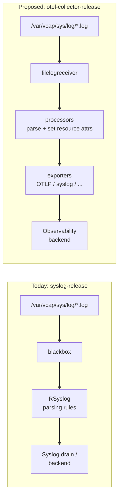

# Meta
[meta]: #meta
- Name: Support Platform Logs Collection and Processing with OpenTelemetry
- Start Date: 2026-09-10
- Author(s): @chombium, @jorbaum, @Katharin4, @beyhan, @silvestre
- Status: Draft
- Related RFCs: [rfc-0018-aggregate-metric-egress-with-opentelemetry-collector](https://github.com/cloudfoundry/community/blob/main/toc/rfc/rfc-0018-aggregate-metric-egress-with-opentelemetry-collector.md)
- RFC Pull Request:
- Affected Component(s): otel-collector-release, cf-deployment

## Summary

Members of the [App Runtime Platform WG](https://github.com/cloudfoundry/community/blob/main/toc/working-groups/app-runtime-platform.md) propose adding support for collection and processing of platform component logs with OpenTelemetry. The goal is to modernize the consumption of platform component logs in Cloud Foundry and add another more modern alternative to the Syslog Protocol. Operators would be able to choose how they want the platform component logs to be processed and forwarded.

We believe that adding OpenTelemetry support for platform component logs will enable more reliable delivery and open possibilities for better processing of the telemetry data downstream inside and outside of Cloud Foundry.

In this RFC, "platform component logs" means the BOSH job logs written to `/var/vcap/sys/log` on component VMs and forwarded off-box by [`syslog-release`](https://github.com/cloudfoundry/syslog-release). It does **not** cover the platform-emitted lines in the per-app Loggregator stream (source types `API`, `RTR`, ...), which reach users via `cf logs` and are unaffected by this proposal.

## Problem

In Cloud Foundry the platform component logs are collected and processed with the [syslog-release](https://github.com/cloudfoundry/syslog-release) which provides a tool to tail log files from `/var/vcap/sys/log` called [blackbox](https://github.com/cloudfoundry/blackbox) and forwarding and processing rules for [RSyslog](https://www.rsyslog.com/). Rsyslog is provided with the stemcell. Rsyslog is highly specialized for parsing and processing text strings and JSON, but is hard to extend (depends on plugins delivered with the stemcell), its configuration is done with ReinerScript and some legacy formats. Rsyslog still has some use cases, but it doesn't fit in the modern observability pipelines.

On the other hand, OpenTelemetry has become the defacto standard in the Observability World and it has a vibrant community.
The OpenTelemetry Collector offers huge advantages over Syslog:
- Can be easily extended with many community managed components like receivers, processors, extensions and exporters from the [opentelemetry-collector-contrib](https://github.com/open-telemetry/opentelemetry-collector-contrib) repository.
- The configuration is standardized yaml.
- The information from all telemetry signals (logs, metrics, traces and baggage) can be easily correlated on the fly while it is still moving through the pipelines which enables faster problem discovery, root cause analysis and problem solving.

## Proposal

We propose adding support to the [otel-collector-release](https://github.com/cloudfoundry/otel-collector-release) for collection and processing of platform component logs in a way that is compatible with what the `syslog-release` currently offers and the use cases it covers. Having the platform component logs and metrics in the same place would enable usage for all of the goodies mentioned above. The `syslog-release` should be analyzed to understand its functionalities and identify how they can be supported by an OpenTelemetry-based alternative.

The `syslog-release` remains the default and stays in place; OpenTelemetry is offered as an opt-in alternative. Operators can choose to run one or both of syslog-release and otel-collector-release in parallel, for example, during migration scenarios. Deprecating or removing the syslog-release is out of scope for this RFC. Upon successful adoption of the OpenTelemetry approach, a future RFC will address the deprecation of syslog-release.

#### Out of scope

This RFC covers only the `blackbox`/RSyslog path that tails `/var/vcap/sys/log` and forwards component logs off-box. It does **not** cover the paths by which some platform component logs reach operators through Loggregator:

- `BOSH jobs → forwarder-agent → syslog-agent → aggregate drain → log-cache`
- `BOSH jobs → forwarder-agent → loggregator-agent → doppler → RLP` (legacy; removed in the shared-nothing architecture)

These are excluded because they are separate transport mechanisms with their own release ownership; folding them in would broaden the scope well beyond a `syslog-release` replacement. They may be addressed in a future RFC.

### Affected Working Groups
- Foundational Infrastructure
- Application Runtime Platform

### Implementation

Cloud Foundry supports platform log collection on two major types of operating systems: Linux with the `syslog-release` and Windows with the [windows-syslog-release](https://github.com/cloudfoundry/windows-syslog-release). To offer a well-integrated opt-in option, both releases should be analyzed so the OpenTelemetry-based approach can complement rather than disrupt existing setups.

#### Focus

This implementation will focus on collection and processing of the platform component logs (BOSH job logs) stored in `/var/vcap/sys/log` directory. Supporting logs stored in other paths is a nice-to-have capability.

The two basic functions of the `syslog-release` will be supported by the OpenTelemetry-based approach as follows:
- blackbox -> [filelogreceiver](https://github.com/open-telemetry/opentelemetry-collector-contrib/tree/main/receiver/filelogreceiver)
- RSyslog parsing rules -> Otel Collector Pipeline with the same functionality. Additional processors and receivers might be needed

The following diagram contrasts today's syslog-based flow with the proposed OpenTelemetry Collector pipeline:

#### Phases

##### Phase 1 - Discovery and Stakeholder Alignment

**Track 1 — Analyze existing releases**

Analyze the internals of both `syslog-release` and `windows-syslog-release` to understand what functionality they provide:
- BOSH jobs
- Configuration parameters
- Access permissions for log files. On Ubuntu Noble and higher the AppArmor rules are enforced.
- Setting of proper context data with attributes like deployment, az, id, instance etc. All the data from [syslog-release-forwarding-setup.conf.erb](https://github.com/cloudfoundry/syslog-release/blob/main/jobs/syslog_forwarder/templates/syslog-release-forwarding-setup.conf.erb) has to be covered.

**Track 2 — Maintain and extend the semantic conventions upstream**

The OpenTelemetry format will follow the [OpenTelemetry Semantic Conventions for Cloud Foundry](https://opentelemetry.io/docs/specs/semconv/resource/cloudfoundry/). Those conventions cover `cloudfoundry.*` attributes and some system-component mappings, but do **not** define the full BOSH-level context (deployment, az, instance-group, instance-id, job).

The App Runtime Platform WG and its [Logging and Metrics team](https://github.com/cloudfoundry/community/blob/main/toc/working-groups/app-runtime-platform.md#logging-and-metrics) are responsible for the Cloud Foundry semantic conventions and, eventually, the BOSH semantic conventions. Following the OpenTelemetry model used by other domain communities, changes will be proposed, reviewed, and maintained in the upstream [OpenTelemetry semantic-conventions repository](https://github.com/open-telemetry/semantic-conventions), in accordance with its contribution and project-management processes, and published on `opentelemetry.io`. A separate project or repository will not be created in the Cloud Foundry community. When upstream work begins, the Cloud Foundry community will be notified of the relevant issue or pull request and invited to collaborate there. The published specification will be linked from the Cloud Foundry documentation.

SAP has internal BOSH conventions which we propose as a starting point for the upstream contribution. Because attribute names are the public contract with every downstream backend, they must be settled and documented before Phase 2 produces stable output.

##### Phase 2 - Implementation

The implementation will be based on the findings from the `Discovery Phase` and will follow the new and modern trends for processing logs with Open Telemetry.

The implementation phase covers two deployment targets:

**BOSH-based CF (cf-deployment)**

- `otel-collector-release` adjustments to support collection and delivery of platform logs:
  - BOSH release:
    - adjust the BOSH jobs, so that they support the same functionality that is provided with the `syslog-release`
  - OpenTelemetry Collector:
    - introduce new receivers, processors and extensions
    - introduce some standard pipeline(s) which process the data in the same way that the current `syslog-release` does
    - add examples on how to do further processing of the data inside the OpenTelemetry Collector
- Ops-file for activating collection and processing of platform component logs with OpenTelemetry
  - The default platform logs forwarding mechanism will remain Syslog up until further notice
- The OpenTelemetry platform component logs delivery will be optional, provided as an add-on, and can be used in parallel to the Syslog based delivery of platform component logs. This would enable the CloudFoundry operators easier migration path of their observability backends from Syslog to Otel based ingestion. As mentioned before, the major difference apart from the protocol will be the change of naming of signals and their attributes which comes with Otel and will be based on the [OpenTelemetry Semantic Conventions for CloudFoundry](https://opentelemetry.io/docs/specs/semconv/resource/cloudfoundry). Any required BOSH extensions will be contributed through the upstream process described in Track 2.
- A performance test will be done and a performance comparison will be presented and documented in order to see the differences in resource (cpu, memory etc.) consumption and reliability of processing and delivering observability data with the `syslog-release` and OpenTelemetry based delivery. The comparison will be done with Otel Collector configuration which is equivalent to all Rsyslogd configuration which comes with the `syslog-release` and other possible BOSH releases and eventually stemcells. No custom Rsyslog configuration ([custom_rules](https://github.com/cloudfoundry/cf-deployment/blob/main/operations/addons/enable-component-syslog.yml#L14)) will be involved during the tests. During performance testing, the log volume should be comparable to that of one of the larger foundations. The log load of the chattiest platform components like cloud controller and similar will be taken into account during the tests.
- A guide for migration from RSyslog to OpenTelemetry platform logs delivery will be written, based on the data collected from the comparison of the features and the results from the performance tests. If one migrates to Otel and still needs to use Syslog, it would be good if the functionality of [syslog-exporter](https://github.com/open-telemetry/opentelemetry-collector-contrib/blob/main/exporter/syslogexporter/README.md) analyzed and compared to the functionality of the `syslog-release` as well. The guide should document and compare the pros and cons of both platform log delivery mechanisms and provide some automated scripts or ops-files which will help the operators make educated decisions and easily migrate to OpenTelemetry for platform component logs. Having this guide in place will enable clear and easy deprecation path of the `syslog-release`

**CF on Kubernetes**

- Investigate how platform component logs are currently collected and forwarded in a CF on Kubernetes deployment
- Define the equivalent opt-in mechanism to enable OpenTelemetry-based log collection alongside the existing approach
- Provide the necessary configuration (e.g. Helm values, overlays) to activate the OpenTelemetry pipeline as an opt-in alternative

#### Deliverables

- Adjusted `otel-collector-release` which supports consumption and processing of platform component logs
- Ops file in [cf-deployment](https://github.com/cloudfoundry/cf-deployment) with which the operators can select the mechanism for forwarding platform logs
- A guide and tooling (ops-files and maybe scripts) for migration from Syslog to OpenTelemetry egress of platform component logs which will enable deprecation of the `syslog-release`
- Any required Cloud Foundry and BOSH semantic-convention extensions published by OpenTelemetry and linked from the Cloud Foundry documentation

## Impact and Consequences

### Positive

- Platform operators will be able to use modern technologies to process Cloud Foundry platform logs 
- Easier integration with other Observability backends
- Ability to correlate platform component logs with platform component metrics and get better insights much faster

### Negative

- When opting in to use OpenTelemetry instead of syslog, operators have to adjust their alerts and dashboards in their observability backends, because the OpenTelemetry Semantic Conventions change the names of the log metadata. This is a one-time cost of adopting the new opt-in path, not a change forced on operators who stay on syslog.
- On the Diego Cells the application logs might affect the throughput and delivery of the platform logs. The operators should set an [application log rate limit](https://docs.cloudfoundry.org/loggregator/app-log-rate-limits.html) in order to limit the produced application logs which are accepted in Loggregator.

## FAQ

### Why extend the `otel-collector-release` instead of creating a new release?

The `otel-collector-release` already deploys an OpenTelemetry Collector to CF VMs for metric egress (see [RFC-0018](https://github.com/cloudfoundry/community/blob/main/toc/rfc/rfc-0018-aggregate-metric-egress-with-opentelemetry-collector.md)). Reusing it keeps platform logs and metrics in the same Collector, which is what enables the cross-signal correlation described above, and avoids operators having to deploy and maintain a second release with an overlapping component set.

### Why not keep RSyslog and just add an OpenTelemetry exporter to it?

That would preserve the parts of the current pipeline we most want to move away from: RSyslog is hard to extend, its configuration relies on RainerScript and legacy formats, and its plugins are tied to the stemcell. Bolting an exporter onto RSyslog carries that maintenance burden forward instead of moving processing into the standardized, community-supported OpenTelemetry Collector configuration.

### Why OpenTelemetry over other log shippers (Fluent Bit, Vector, etc.)?

OpenTelemetry has become the de facto standard in the observability space, has a large and active community, and is already established in Cloud Foundry via the `otel-collector-release` for metrics. Standardizing on a single collector for logs and metrics reduces the agent footprint and the number of distinct configuration formats operators have to learn.

## Open Questions

- **Windows parity.** Can the OpenTelemetry Collector / `filelogreceiver` cover everything `windows-syslog-release` does, and with acceptable resource usage on Windows cells? To be answered in Phase 1.
- **Log-file access permissions.** On Ubuntu Noble and higher, AppArmor rules are enforced. What changes are needed for the Collector to read `/var/vcap/sys/log` under those rules?
- **Non-standard log paths.** Handling logs stored outside `/var/vcap/sys/log` is currently listed as nice-to-have — do any in-scope components require it?

