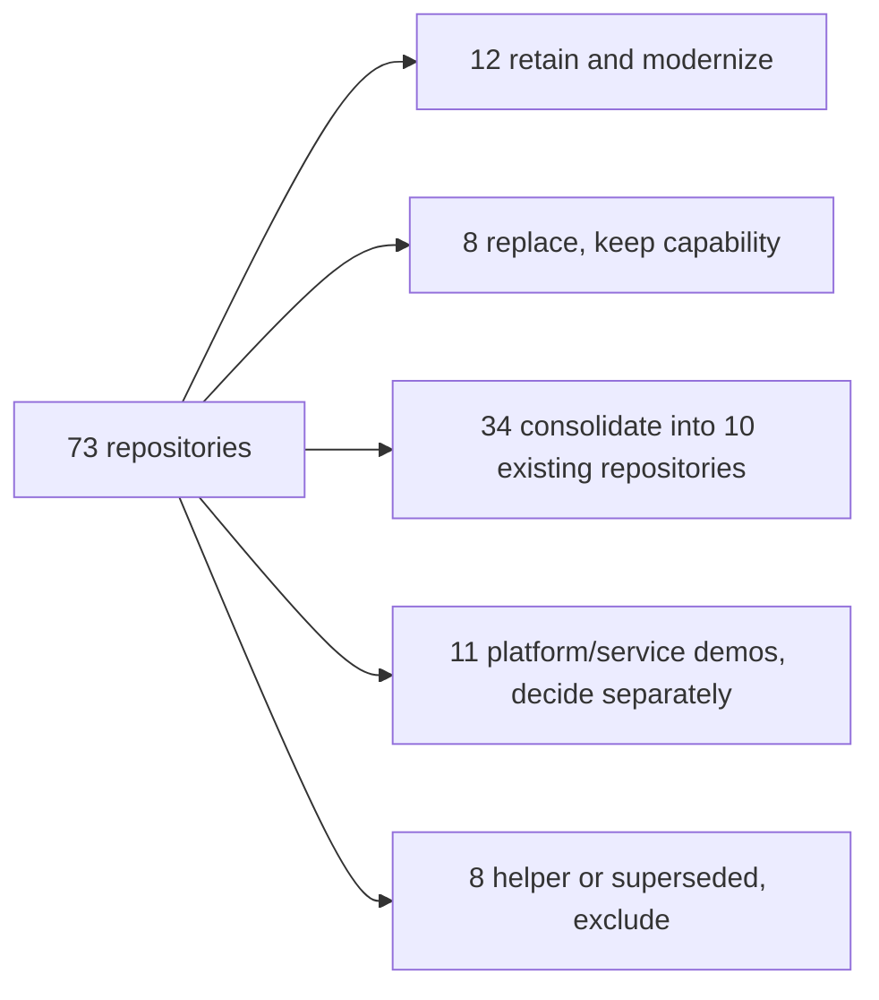
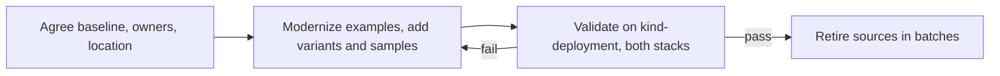

# Meta
[meta]: #meta
- Name: Sample Application Migration and Portfolio Consolidation
- Start Date: 2026-10-09
- Author(s): @benjaminguttmann-avtq
- Status: Draft
- RFC Pull Request: https://github.com/cloudfoundry/community/pull/1657/changes
- Related RFCs:
- Approving Working Groups: Buildpacks and Stacks; Docs
- Affected Component(s): cloudfoundry-samples repositories; sample documentation and validation for classic Cloud Foundry buildpacks

## Summary

Maintain a focused set of Cloud Foundry sample applications instead of migrating
all 73 historical repositories in cloudfoundry-samples unchanged. Preserve distinct
deployment capabilities, consolidate redundant examples, close buildpack coverage
gaps, and keep examples current through automated dependency updates and
deployment tests.

A static source review, embedded in the Appendix, recommends retaining 12 examples,
replacing 8 while preserving their capabilities, consolidating 34 into 10 existing
repositories, deciding 11 platform/service demos separately, and excluding 8 helper
or superseded projects. Validation will use kind-deployment with the latest
published release of each respective buildpack on all available stacks, currently
cflinuxfs4 and cflinuxfs5.
The Buildpacks and Stacks and Docs working groups review this proposal. It reports
no successful deployments and does not authorize archiving or deleting repositories.

## Problem

The organization holds many historical applications: overlapping framework
examples, obsolete instructions, service demos and helper projects. Migrating them
unchanged carries forward duplicate maintenance and unsupported assumptions;
dropping them by age or language would lose useful deployment examples.

Language coverage is not feature coverage. A Spring Boot JAR and a Tomcat WAR
differ, a JRuby app packaged as a WAR does not show JRuby on the Ruby buildpack,
and a Go sidecar is not a Binary buildpack example. Old PHP samples depend on
Python user extensions that the reviewed PHP buildpack no longer supports. No
sample uses Staticfile, Nginx, R or Binary.

The planned test environment needs preparation. The kind-deployment
[README](https://github.com/cloudfoundry/kind-deployment/blob/ad1ec94eacfdd41c09babb07d5290d12bdeef120/README.md)
documents Java, Node.js, Go and Binary as the default bootstrap; its
[upload script](https://github.com/cloudfoundry/kind-deployment/blob/ad1ec94eacfdd41c09babb07d5290d12bdeef120/scripts/upload_buildpacks.sh)
reads buildpack versions from `versions.yaml`, covers cflinuxfs4 and cflinuxfs5,
and adds more buildpacks for the complete bootstrap. Apt is in neither set, so a
bootstrap alone guarantees neither the latest buildpacks nor a full two-stack matrix.

## Proposal

### Goals and non-goals

- Maintain a clear, owned set of examples for distinct CF deployment capabilities.
- Reduce duplicates without losing packaging, worker or composition paths.
- Keep examples current through automated dependency updates and deployment tests.

Out of scope are Paketo/CNB, buildpack or CF runtime changes, and preserving the
business workflows of old applications: replacements keep only the selected
deployment and configuration demonstrations. Known users of excluded functionality
MUST get an owner decision before a source repository is retired. The analysis built
and deployed nothing; recipes and variants are proposals, not evidence of working staging.

### Portfolio decisions

The counts are proposals from the 2026-10-07 snapshot, not a claim that every
example works today. Record the reason when new evidence changes a decision.

The proposed retain-and-modernize set is:

| Repository | Demonstration to retain |
| --- | --- |
| cf-sample-app-nodejs | Basic Node.js deployment. |
| cf-sample-app-rails | Rails deployment, with database/migration variants to add. |
| cf-sample-app-spring | Small Spring deployment example. |
| spring-music | Spring Boot and database-service integration. |
| ruby-sample-app | Minimal Sinatra deployment, distinct from Rails. |
| pong_matcher_django | Python/Django and database integration. |
| dotnet-core-hello-world | ASP.NET Core deployment with a current runtime target. |
| test-app | Go deployment and CF diagnostic endpoints. |
| cf-ex-php-info | PHP runtime/extension diagnostics without exposing secrets. |
| cf-ex-composer | Composer dependencies and PHP extension requirements. |
| cf-ex-stand-alone | PHP CLI/non-web processes and CF tasks. |
| cf-ex-pgbouncer | Apt plus PHP, package installation and an additional process. |

The eight capability-preserving replacement cases are:

- cf-ex-phalcon
- cf-ex-phpmyadmin
- jruby-rails-bookshelf
- pong_matcher_groovy
- resque-sample
- spring-batch-tweet-workers
- springmvc-hibernate-template
- zentasks-scala-cloudfoundry

Preserve their capabilities through current variants; do not assume Phalcon
availability, legacy PHP extension compatibility, or that WAR-packaged JRuby
covers direct JRuby.

The eleven platform/service demos need separate owner decisions:

- capi-sidecar-samples
- cf-autoscaler
- cf-s3-demo
- fib-cpu
- github-service-broker-ruby
- go_service_broker
- http2_tile_demo
- rabbitmq-cloudfoundry-samples
- rails-elastic-search
- ratelimit-service
- multi-process-sample

Consolidation selects rabbitmq-cloudfoundry-samples as the messaging destination;
archiving it MUST block dependent retirements until a revised destination is validated.

### Consolidation

Consolidation keeps a smaller set of representative demonstrations; it does not merge
business applications. Each of the 34 candidates maps to one of 10 existing
destination repositories (six retained, three replacements, one platform demo).
These are not new repositories or the final portfolio size. The
[Appendix](#consolidation-destinations-and-missing-variants) lists destinations and
missing variants; the [mapping](#source-to-destination-mapping) gives each source's
existing coverage, required additions and excluded scope.

Keep variants small and independently deployable, and implement shared variants once
per destination. For example, enki, rails_sample_app and pong_matcher_rails map to
cf-sample-app-rails, which first needs MySQL/PostgreSQL bindings and migrations;
their blog, tutorial and Pong workflows are not replaced.

### Coverage additions

Add small samples for Staticfile, Nginx, R and Binary, starting from the buildpacks'
fixtures; variants MAY share a repository, and names and locations are open. Preserve
Java WAR, executable JAR, Groovy source, Play and DistZip paths, direct JRuby, PHP
CLI/tasks and Apt composition. Add Yarn/pnpm, published .NET artifacts and vendored
dependency variants to existing examples. Distinguish app-side service configuration
from buildpack-injected integrations, and verify the PHP JSON user-extension loader
before relying on it.

### Ownership and maintenance

Both the Buildpacks and Stacks and the Docs working groups approve this RFC.
Repository ownership changes, creation, renaming or archiving follow the
[repository ownership process](rfc-0007-repository-ownership.md), including TOC and
affected working-group approvals. A destination organization is not assumed; agree it,
owners, permissions and security responsibility before any move, prefer GitHub
transfers, and check history, issues, releases, redirects and CI integrations.

The Docs working group owns the sample applications and assigns a named maintainer
to each. Each maintained example needs a feature goal, runnable instructions, required
services and recorded runtime/buildpack/stack support. Tests establish only the
recorded combinations. Capacity is open; no dates, costs or savings are established.

### Automated dependency maintenance

Maintained repositories MUST configure automated update PRs (Dependabot, Renovate or
equivalent) for all sample and variant directories, covering manifests, lockfiles and
CI dependencies. Owners handle unsupported ecosystems.

Update PRs run build/unit tests and feature smoke tests on kind-deployment with the
latest published buildpack releases on all available stacks. Failed, missing, skipped or stale
required checks MUST block merging.

Repositories can auto-merge dependency-only PRs from trusted automation without
maintainer review under an owner-approved policy. Start with patch/minor updates
covered by tests; a version label alone is no evidence of compatibility. Auto-merge
cannot bypass required checks. Major versions, runtime-target changes, CI/test changes
and anything outside the policy MUST get maintainer review. If an auto-merged update
breaks an example, pause that update class, revert or fix, and rerun the stack matrix
before re-enabling. Use least-privilege automation credentials and keep validation
access away from untrusted PR code. This automation is proposed, not configured.

## Rollout and validation

Before each validation run, resolve the latest published release of each capability's
buildpack (plus Apt for the composition example) and record its exact version or
artifact; do not assume the bootstrap pins are latest, and do not use unreleased builds. Install missing or outdated artifacts through the CF
buildpack API/CLI, verify installed buildpacks and stacks, select each stack
explicitly, and record the kind-deployment revision. Unavailable or failing
combinations stay blocked, not skipped.

Tests demonstrate the selected feature: actual Apt package use, worker health checks,
sidecar memory/process behavior, the detected container and startup command, and
HTTP, task and binding smoke tests. Offline claims need a test without dependency
network access. Provide service instances, isolate test data and credentials, and never
publish secrets. Keep a checklist per variant with source, destination, owner,
revision, tested artifacts, stack, result and retirement approval.

## Retirement criteria

A source repository MUST NOT be archived until:

- its replacement capabilities are validated, or its owner agrees none is needed;
- known users and documentation references are checked, and dependence on excluded
  functionality is resolved;
- its README names its disposition, successor and limitations, and community-controlled
  references are updated;
- useful tests and recipes are preserved and required governance approvals are recorded.

Prefer archiving; this RFC authorizes no deletion. Archived examples are not
production-ready applications. If validation fails, postpone retirement; if a later
failure invalidates a replacement, repair it and revisit the source's disposition. Old
runtimes are not a fallback.

## Alternatives considered

| Alternative | Assessment |
| --- | --- |
| Migrate all 73 unchanged | Keeps breadth but carries obsolete instructions and duplicates forward. |
| One application per language | Loses packaging, worker and composition capabilities. |
| Archive outdated repositories now | Removes references without validated successors. |
| One large multi-feature application | Couples unrelated services; harder to validate. |

## Risks and trade-offs

| Failure scenario | Response |
| --- | --- |
| A destination lacks a required DB, worker or packaging variant. | Implement and validate it before retiring dependent sources. |
| The bootstrap provides older or missing buildpacks or stacks. | Prepare and verify the matrix; leave validation blocked. |
| A service-dependent test cannot run. | Block merge and retirement; HTTP-only tests cannot prove bindings or workers. |
| Auto-merge passes incomplete tests but breaks an example. | Pause that policy, fix, and add a regression check. |
| A user still needs excluded business functionality. | Resolve with the owner before archiving. |

Less duplicate maintenance costs shared variants, a two-stack test environment and
dependency automation. Destinations need committed owners; neither effort nor savings
is measured. A moving latest-buildpack matrix can expose upstream regressions, so
diagnose failures instead of relaxing criteria. Success means every repository has a
recorded disposition, retirements passed their gates, and examples have owners,
validated deployments and dependency automation; it does not mean exactly ten
repositories remain.

## Open decisions before implementation

- Which destination organization, if any, and which ownership/charter entries and
  RFC 0007 approvals are involved?
- What capacity does the Docs working group have for the retained examples,
  replacements and new buildpack samples?
- Which service instances and access does kind-deployment provide, and who maintains
  repeatable validation?
- What are the owner decisions for the 11 platform/service demos and 8 helper or
  superseded projects?

## Appendix

### Consolidation destinations and missing variants

These are the ten existing destinations selected for the 34 consolidation
candidates. The required work is proposed, not already implemented. Keep each
variant independently deployable.

| Destination | Selected repository | Required work from the consolidation plan |
| --- | --- | --- |
| T-GO | test-app | Bound MySQL variant with a minimal persistent API and schema/migration step. |
| T-NODE | cf-sample-app-nodejs | MySQL API, WebSocket echo, native-module staging check and UTF-8 response test. |
| T-RAILS | cf-sample-app-rails | MySQL/PostgreSQL bindings, controlled migration tasks, Unicorn start profile and mail recipe. Current baseline uses SQLite. |
| T-RUBY | ruby-sample-app | Bound Redis read/write example; a genuine worker remains a separate capability-preserving replacement. |
| T-SPRING | spring-music | Validate existing SQL/MongoDB/Redis profiles; add redacted environment visibility and a mail recipe. |
| T-WAR | springmvc-hibernate-template | Reduce to a current WAR/servlet example with relational binding and cache configuration. |
| T-JAVA | spring-batch-tweet-workers | Separate executable Java Main web JAR and bin/lib worker-distribution variants. |
| T-DIST | pong_matcher_groovy | Modernize DistZip/Ratpack; add generic launcher/PORT and a protocol echo variant. |
| T-PHP | cf-ex-composer | MySQL/PostgreSQL bindings, routed API and supported artifact-preparation recipe; no legacy Python download hooks. |
| T-AMQP | rabbitmq-cloudfoundry-samples | Modern Java producer/worker and Node consumer, deterministic input, streaming variant and shared smoke tests. |

### Sample application analysis

The technical analysis below is part of this RFC, not a separately hosted or
separately merged document. It preserves the reviewed source snapshots and
recommendations so the decision remains auditable if working documents are lost.
The source review is dated 2026-10-07; the concrete consolidation mapping was
completed during the subsequent review. These are static findings, not evidence
of current deployment success. The proposal and validation requirements above
govern implementation; the historical analysis does not replace those requirements.

- [Buildpack coverage and gaps](#buildpack-matrix)
- [All 73 repository decisions](#decision-matrix-all-73-repositories)
- [The 34 consolidation mappings](#source-to-destination-mapping)

#### Scope and methodology

Scope: all 73 public repositories in
[cloudfoundry-samples](https://github.com/cloudfoundry-samples) and the twelve
classic Cloud Foundry buildpacks specified in the request. Paketo/CNB are
outside the scope of this analysis.

- The review covers READMEs, deployment configuration, dependency files, and
  relevant implementation code. Current buildpack implementations and their
  test fixtures provide the feature reference, rather than product names alone.
- **Explicit**: The sample enables or explains the relevant variant.
  **Basic**: An ordinary language application uses the buildpack path without
  demonstrating a particular option. **Historical**: The intent is documented,
  but the old deployment does not confirm that the feature works today.
- Service bindings, routing, sidecars, multiple CF processes, and scaling are
  CF/application capabilities. They do not automatically count as buildpack integrations.
- Age alone is not a reason to exclude a sample. The deciding factors are its
  distinct demonstration value and a clear replacement for duplicate examples.
- No applications were built, staged, or started on CF. Coverage here means
  source/configuration evidence, not successful execution on a current platform.
- Recommendations concern migration and archiving. This analysis does not
  delete, archive, or modify any of the reviewed repositories.

#### Verified special case: Apt plus PHP

[cf-ex-pgbouncer](https://github.com/cloudfoundry-samples/cf-ex-pgbouncer) is
not simply another PHP web application example:

- [manifest.yml](https://github.com/cloudfoundry-samples/cf-ex-pgbouncer/blob/36d08cdf8096/manifest.yml)
  specifies an Apt and PHP buildpack chain.
- [apt.yml](https://github.com/cloudfoundry-samples/cf-ex-pgbouncer/blob/36d08cdf8096/apt.yml)
  requests the `pgbouncer` package.
- The README describes `.profile`, `VCAP_SERVICES`, and the additional
  PgBouncer process. This is historical evidence of package installation and
  multi-buildpack composition, not runtime validation of the old pinned version.
- Recommendation: Preserve the capability; update the deployment to current
  buildpacks or replace it with a smaller Apt-plus-PHP example. Do not discard
  it as a duplicate PHP sample without providing a replacement.

#### Decision summary

**Do not migrate every old application, but do not consolidate by language alone.**
A small portfolio with explicit packaging and configuration variants provides
more value than many old framework demonstrations. Prefer archiving historical
repositories over deleting them once replacements, references, and users have
been accounted for.

Recommendation totals: **12 B**, **8 E**, **34 K**, **11 P**, **8 A**;
73 repositories in total. B/E/P do not imply continuing to run the applications unchanged.
The original decision codes are retained; their definitions appear below the
buildpack matrix.

- Retain/modernize: canonical language applications and examples for Composer,
  PHP CLI, Apt, Spring Boot, Rails, and Go Modules.
- Replace selectively: classic Java WAR, Play/DistZip, and JRuby examples.
  The old implementation is not necessarily worth preserving, but the distinct
  deployment method is.
- Consolidate: additional MVC, CMS, Pong, and messaging variants where they do
  not demonstrate a different packaging/configuration capability or a desired
  service integration.
- Decide separately: sidecars, CF processes, HTTP/2 routing, route services,
  service brokers, and load generators have platform value beyond this audit.
- Explicit introductory examples are missing for **Staticfile, Nginx, R, and Binary**.
  Apt has historical coverage; it is not entirely unrepresented.

#### Buildpack matrix

Source links pin the reviewed commit. A fixture demonstrates an intended
variant, not necessarily a test successfully executed during this analysis.
The gaps are prioritized, user-relevant variants, not an exhaustive list of
every internal flag and agent version.

| Buildpack / source snapshot | Current reference capabilities | What the samples demonstrate | Missing or not explicitly demonstrated |
| --- | --- | --- | --- |
| [Java](https://github.com/cloudfoundry/java-buildpack/tree/7155ba6557a8) | Container registry: Spring Boot, Tomcat, Groovy, Play, DistZip, Java Main; JRE/memory configuration; framework/agent registry | Boot JAR: `spring-music`, `hello-spring-cloud`, Spring Pong; WAR: Spring MVC/Grails/JRuby Warbler; Play: zentasks; Ratpack distribution: Groovy Pong; historical Java Main/worker start commands; sidecar memory configuration | Standalone modern Java Main JAR; Groovy source container; current WAR with a Jakarta/Servlet variant; explicit memory/GC/debug/JMX/truststore and agent configuration; Java CF Env injection distinguished from application-side connectors |
| [Python](https://github.com/cloudfoundry/python-buildpack/tree/f0f44b344c58) | pip/requirements, Pipenv, setup.py, runtime selection, vendored dependencies, hooks/NLTK; see `fixtures/` and Supply | `pong_matcher_django`: requirements, Django, Gunicorn, native database drivers, explicit Procfile with migrations | Small Flask example; Pipenv; setup.py; vendored/offline dependencies; runtime selection; hooks/NLTK as optional advanced examples |
| [Node.js](https://github.com/cloudfoundry/nodejs-buildpack/tree/28d99c661d51) | npm, Yarn, pnpm, workspaces, vendored dependencies/binaries, start/build configuration, runtime/memory configuration | npm/Node startup in the canonical application, Sails, Subway, and others; multi-process Procfile; native dependencies such as bcrypt in Subway | Yarn and pnpm including workspaces; explicit build step using devDependencies; vendored/offline variant; deliberate memory/runtime configuration. Socket.IO and UTF-8 are not distinct buildpack features |
| [.NET Core](https://github.com/cloudfoundry/dotnet-core-buildpack/tree/ccc0f68b9ed4) | Publishing from source, framework-dependent DLL/executable, self-contained artifacts, SDK selection/global.json, multiple projects, NuGet, F#, supply combinations; see Fixtures/Finalize | `dotnet-core-hello-world`: ASP.NET Core source project, `CACHE_NUGET_PACKAGES: false`; target `netcoreapp2.1`, not evidence of current compatibility | Published FDD/FDE/SCD variants; console/worker; global.json; multiple projects; F#; focused NuGet/supply demonstration |
| [Go](https://github.com/cloudfoundry/go-buildpack/tree/eb89e61208fc) | Modules, vendored modules, toolchain/version selection, ldflags, install-package specification; historical Godep/Glide/dep paths; see Fixtures | `test-app`, Go Pong, route service, and HTTP/2 application with go.mod; explicit Procfiles; older broker/Lattice paths using Godeps | Deliberate vendored/offline module variant, ldflags, multiple binaries/package specification, toolchain configuration; new demonstrations of historical dependency managers are not a priority |
| [Ruby](https://github.com/cloudfoundry/ruby-buildpack/tree/7640eb2ac9cc) | MRI and JRuby, Bundler, Rails/Rack/Sinatra, asset precompilation, vendor/cache and vendor/bundle, runtime selection, multi-buildpack composition; see Fixtures | Basic Sinatra, Rails, explicit Ruby selection/Procfiles, database migrations; JRuby Bookshelf instead describes WAR deployment | **JRuby directly through the Ruby buildpack**; clear asset precompilation/Node supply case; vendored/offline gems; current runtime configuration |
| [Staticfile](https://github.com/cloudfoundry/staticfile-buildpack/tree/d71dc5e7ee9b) | Static content, root, pushstate, Basic Auth, HTTPS redirect, HSTS, HTTP/2, SSI, directory index, custom errors, reverse proxy; see Fixtures | No explicit sample for this buildpack found | Entire introductory example; small SPA/root variant plus authentication/HTTPS configuration. The Go HTTP/2 demonstration does not cover these flags |
| [Nginx](https://github.com/cloudfoundry/nginx-buildpack/tree/f7c3259d3121) | Custom nginx.conf, templated environment/PORT/includes, stable/mainline/OpenResty, stream module, logging; see Fixtures | No explicit sample for this buildpack found | Entire introductory example; reverse proxy with PORT/environment template; optional OpenResty/stream. PHP using Nginx would not demonstrate this buildpack either |
| [Apt](https://github.com/cloudfoundry/apt-buildpack/tree/b9d3ef99a50a) | apt.yml packages, custom repos/keys, cleancache, supply before another buildpack; see README/Fixtures | `cf-ex-pgbouncer`: PgBouncer package plus Apt/PHP chain; historical Apt pin | Validate the current chain/stack compatibility; custom repository and signing key; cache behavior. No new basic repository is needed if PgBouncer is replaced/modernized |
| [PHP](https://github.com/cloudfoundry/php-buildpack/tree/3d357ff94915) | HTTPD/Nginx/PHP-FPM, CLI/APP_START_CMD, Composer/version/ext requirements, PHP/Zend extensions, .bp-config overrides, preprocessing, sessions/APM, additional processes | phpinfo enables HTTPD and many extensions; Composer with php/ext requirements and post-install; explicit Phalcon; CLI/tasks; PgBouncer; Drupal/database tools using old Python extensions | Explicit Nginx profile, FPM/php.ini configuration, Redis/Memcached sessions, current APM example, clear APP_START_CMD/preprocessing variant; JSON user extensions **claimed only in documentation/tests, implementation evidence still unresolved**, see below |
| [R](https://github.com/cloudfoundry/r-buildpack/tree/7567b7510021) | r.yml/CRAN packages, install.R, native/Fortran dependencies, vendored packages; fixtures for Shiny, Plumber, and Rserve | No R buildpack sample found | Entire introductory example; start with a Plumber API and Shiny variant; optionally vendored packages/native dependencies/Rserve |
| [Binary](https://github.com/cloudfoundry/binary-buildpack/tree/74589ec4a719) | Prebuilt application with an explicit start command/Procfile, combination with a supply buildpack; see Fixtures/Finalize | No explicit Binary buildpack deployment found. Go binary sidecars run within the Ruby/Java droplet | Small Linux binary with PORT, Procfile, and `binary_buildpack`; optional supply chain. Docker deployment does not count as Binary buildpack coverage either |

##### Important distinctions

1. **JRuby Bookshelf is a WAR example.** Its
   [README](https://github.com/cloudfoundry-samples/jruby-rails-bookshelf/blob/a1cc0012b2fc/README.md)
   instructs users to run `jruby -S warble` and push `bookshelf.war`. This does
   not demonstrate JRuby detection/installation by the Ruby buildpack. A modern
   direct JRuby variant is missing despite the repository name.
2. **Groovy Pong demonstrates Ratpack/DistZip, not Groovy source deployment.**
   Its [build.gradle](https://github.com/cloudfoundry-samples/pong_matcher_groovy/blob/5cd1a391fa8c/build.gradle)
   and manifest produce/push `build/distributions/app.zip`. The Java
   [container registry](https://github.com/cloudfoundry/java-buildpack/blob/7155ba6557a8/src/java/containers/container.go)
   distinguishes Groovy from DistZip. Plan for both capabilities separately
   when replacing examples.
3. **Service connectivity is not automatically buildpack auto-configuration.**
   `hello-spring-cloud` uses Spring Cloud Connectors within the application.
   The `spring-music` [manifest](https://github.com/cloudfoundry-samples/spring-music/blob/8f364e93a29e/manifest.yml)
   even sets `JBP_CONFIG_SPRING_AUTO_RECONFIGURATION` to `enabled: false`.
   These samples therefore do not establish Java CF Env/JDBC injection in general.
4. **PHP user extensions require a migration decision.** `cf-ex-phpmyadmin`
   and `cf-ex-drupal` contain Python 2 `extension.py` files with build-time
   downloads. The current [integration test](https://github.com/cloudfoundry/php-buildpack/blob/3d357ff94915/src/php/integration/python_extension_test.go)
   explicitly marks this path as unsupported using `it.Pend`. README/FEATURES
   and a test claim JSON extension support; however, the actual
   [LoadUserExtensions](https://github.com/cloudfoundry/php-buildpack/blob/3d357ff94915/src/php/extensions/extension.go)
   reads PHP INI extension lists. No `extension.json` loader was found in the
   non-test Go code. Execute a JSON replacement or clarify the implementation
   before recommending it; do not mechanically translate old download hooks.
5. **Do not promise PHP extensions based on the old lists.** phpinfo requests,
   among others, Phalcon/phpiredis, while Drupal requests mcrypt/apc. Such
   historical requests establish demonstration intent, not a guarantee that
   current PHP/stack combinations include these modules. Check the current
   manifest before migration.
6. **HTTP/2 and sidecars have their own platform relevance.** The
   [HTTP/2 manifests](https://github.com/cloudfoundry-samples/http2_tile_demo/blob/4055381a4199/manifest.yml)
   use Go and route protocols. The
   [Java sidecar configuration](https://github.com/cloudfoundry-samples/capi-sidecar-samples/blob/e564032250bf/sidecar-dependent-java-app/manifest.yml)
   reserves memory for the sidecar. This demonstrates an important Java/CF
   interaction, but not a successful test of the current memory calculator.

#### Decision matrix: all 73 repositories

Repository links pin the reviewed sample commit. The findings column identifies
the observed purpose and, where relevant, the specific artifact.

- **B**: Retain and modernize; clear core or feature value.
- **E**: Preserve the capability, preferably replacing the old implementation
  with a small current example; archive the old repository only afterwards.
- **K**: Consolidate/archive once the named replacement provides the desired
  functionality. No distinct buildpack feature identified.
- **P**: Decide separately whether to retain, replace, or archive the
  platform/service demonstration; buildpack coverage alone is not sufficient.
- **A**: Do not migrate as a sample application; supporting project or an
  already superseded repository.

| Repository / source snapshot | What it demonstrates | Recommendation and rationale |
| --- | --- | --- |
| [bitshow](https://github.com/cloudfoundry-samples/bitshow/tree/7fc5c689d1bf) | Scala image processing, MongoDB, ZIP with explicit java -jar; V1 manifest | K: Preserve the Java Main variant in a small replacement; the complex image application is unnecessary |
| [capi-sidecar-samples](https://github.com/cloudfoundry-samples/capi-sidecar-samples/tree/e564032250bf) | Ruby/Java parent applications, Go/WireMock sidecars; Java memory reservation | P: Strong standalone CF sidecar value; modernize, but not evidence of Binary buildpack usage |
| [cf-autoscaler](https://github.com/cloudfoundry-samples/cf-autoscaler/tree/88fca2e47945) | RabbitMQ producer/worker and custom autoscaler using a CF client | P: Evaluate the scaling demonstration separately; no unique language buildpack mode |
| [cf-ex-code-igniter](https://github.com/cloudfoundry-samples/cf-ex-code-igniter/tree/0a7a83211af4) | PHP MVC framework with web/database configuration | K: Move framework configuration into the canonical PHP application if desired |
| [cf-ex-composer](https://github.com/cloudfoundry-samples/cf-ex-composer/tree/510c40df456a) | Composer, PHP version/ext requirements, post-install script | B: Clear buildpack feature; modernize dependencies |
| [cf-ex-drupal](https://github.com/cloudfoundry-samples/cf-ex-drupal/tree/7a06af94ea94) | CMS, MySQL, PHP modules, Python extension downloading Drupal | K: Assess CMS value separately; the legacy hook cannot be migrated as before; replace with a Composer/CMS recipe |
| [cf-ex-pgbouncer](https://github.com/cloudfoundry-samples/cf-ex-pgbouncer/tree/36d08cdf8096) | apt.yml, Apt+PHP, .profile/.procs, additional process | B: Uncommon explicit Apt/supply coverage; modernize the pin, stack, and process path |
| [cf-ex-phalcon](https://github.com/cloudfoundry-samples/cf-ex-phalcon/tree/230710d85566) | Explicit native PHP extension plus PDO/MySQL | E: Preserve native extension selection; do not assume Phalcon availability; use a current extension as a replacement if necessary |
| [cf-ex-php-info](https://github.com/cloudfoundry-samples/cf-ex-php-info/tree/ef91416b156e) | HTTPD, PHP/Zend extension selection, phpinfo diagnostics | B: Good basic PHP introduction; update the module list and do not publicly expose diagnostics containing secrets |
| [cf-ex-phpmyadmin](https://github.com/cloudfoundry-samples/cf-ex-phpmyadmin/tree/3d3b1cc89a48) | Database administration UI, service credentials, Python download extension | E: Redesign the custom installation/configuration example; do not migrate unchanged to PHP v5 |
| [cf-ex-phppgadmin](https://github.com/cloudfoundry-samples/cf-ex-phppgadmin/tree/688e2325cbd2) | PostgreSQL administration UI, manual download according to README | K: No distinct buildpack mode beyond a PHP web/database example; retain the administration UI only if independently needed |
| [cf-ex-stand-alone](https://github.com/cloudfoundry-samples/cf-ex-stand-alone/tree/d2d49bc3a53b) | WEB_SERVER=none, PHP CLI, process health check, CF tasks | B: Preserve the non-web path and tasks; validate APP_START_CMD against the current implementation |
| [cf-ex-wordpress](https://github.com/cloudfoundry-samples/cf-ex-wordpress/tree/b3d916ab350b) | WordPress installation instructions, PHP version/database recipe | K: One CMS recipe is sufficient; address upload persistence separately |
| [cf-php-demo](https://github.com/cloudfoundry-samples/cf-php-demo/tree/ce29677fdd93) | PHP/PostgreSQL, manifest referencing an old external Apache buildpack | K: Move database access into a canonical PHP example; not evidence of the current official buildpack |
| [cf-s3-demo](https://github.com/cloudfoundry-samples/cf-s3-demo/tree/5b27df9a71a3) | JVM application with S3 object storage/user-provided service instance recipe | P: Preserve the S3/persistence demonstration if the service example is needed; no distinct Java container mode |
| [cf-sample-app-nodejs](https://github.com/cloudfoundry-samples/cf-sample-app-nodejs/tree/18cc56ed2f4c) | Canonical Node deployment, package.json/manifest | B: npm baseline; add Yarn/pnpm/build variants here |
| [cf-sample-app-rails](https://github.com/cloudfoundry-samples/cf-sample-app-rails/tree/47bb81f07dc1) | Canonical Rails deployment, Gemfile/Procfile/manifest | B: Rails baseline; explicitly document assets, vendored gems, and database migrations |
| [cf-sample-app-spring](https://github.com/cloudfoundry-samples/cf-sample-app-spring/tree/8a1064ed1c03) | Canonical Spring deployment with the Java buildpack | B: Small JVM introduction alongside the more extensive database demonstration |
| [cloudfoundry-android](https://github.com/cloudfoundry-samples/cloudfoundry-android/tree/d14e1217a548) | Android client for managing CF, not a CF-hosted server application | A: Exclude from buildpack sample migration; archive the historical client or assign a separate owner |
| [cloudfoundry-env](https://github.com/cloudfoundry-samples/cloudfoundry-env/tree/23fc53dc6b79) | Ruby gem for reading the CF environment, test application | A: Library rather than standalone showcase; check library users separately |
| [docs-riakcs](https://github.com/cloudfoundry-samples/docs-riakcs/tree/267d10c6426e) | Riak CS documentation | A: Handle documentation separately; not a buildpack application |
| [dotnet-core-hello-world](https://github.com/cloudfoundry-samples/dotnet-core-hello-world/tree/420b014d8f57) | ASP.NET Core source application, csproj/netcoreapp2.1, NuGet cache option | B: Only .NET introduction; add a current target and published artifact variants |
| [enki](https://github.com/cloudfoundry-samples/enki/tree/ed7c76f7be1b) | Rails blog/MySQL, old rails3 manifest path | K: The canonical Rails application replaces the baseline; blogging is not a buildpack feature |
| [fib-cpu](https://github.com/cloudfoundry-samples/fib-cpu/tree/65d37d14ec8b) | Ruby CPU load, Unicorn for multiple cores | P: Small load/scaling test; do not confuse it with Rails feature coverage |
| [github-service-broker-ruby](https://github.com/cloudfoundry-samples/github-service-broker-ruby/tree/557463abd1c3) | Sinatra service broker plus example application | P: Evaluate the OSB demonstration separately against the current API contract |
| [github-services](https://github.com/cloudfoundry-samples/github-services/tree/8529ab2e3653) | Historical GitHub service hooks/integrations | A: Not a CF buildpack showcase; assess any need for historical integration code separately |
| [go_service_broker](https://github.com/cloudfoundry-samples/go_service_broker/tree/6d1d515bdb41) | Go/Godeps, OSB VM provisioning, asynchronous operations/service keys | P: Broker behavior has independent value; no reason to preserve Godeps as a new buildpack demonstration |
| [grails-petclinic](https://github.com/cloudfoundry-samples/grails-petclinic/tree/45fcb747db87) | Grails web application and old CF service plugin | K: A small current WAR example replaces the buildpack value; assess Grails community needs separately |
| [hello-spring](https://github.com/cloudfoundry-samples/hello-spring/tree/6e9368e80799) | Older introduction to Spring/cloud services | K: Replace with the canonical Spring application/current binding recipe |
| [hello-spring-cloud](https://github.com/cloudfoundry-samples/hello-spring-cloud/tree/bc0c39f824c9) | Boot JAR with application-side Spring Cloud Connectors/service information | K: Transfer the purpose to a modern Spring binding example; not evidence of buildpack injection |
| [http2_tile_demo](https://github.com/cloudfoundry-samples/http2_tile_demo/tree/4055381a4199) | Go Modules application with HTTP/1 and HTTP/2 routes and H2C | P: Preserve the HTTP/2 routing demonstration; do not count it as Staticfile/Nginx coverage |
| [issue-guidelines](https://github.com/cloudfoundry-samples/issue-guidelines/tree/cd555cdd7106) | Reusable CONTRIBUTING guidelines | A: Not an application repository; potentially incorporate into organization guidelines |
| [jruby-rails-bookshelf](https://github.com/cloudfoundry-samples/jruby-rails-bookshelf/tree/a1cc0012b2fc) | Rails/JDBC under JRuby, Warbler WAR deployment | E: Preserve the JRuby purpose with a new direct Ruby buildpack variant; document the WAR case separately |
| [lattice-app](https://github.com/cloudfoundry-samples/lattice-app/tree/5aece997e8e5) | Historical Go test application; README points to test-app as its replacement | A: Already deprecated; migrate test-app, not both |
| [multi-process-sample](https://github.com/cloudfoundry-samples/multi-process-sample/tree/7da198e5ef2e) | Node, Procfile web/worker, separate CF process scaling | P: Preserve a clear, distinct CF process demonstration |
| [pong_matcher_acceptance](https://github.com/cloudfoundry-samples/pong_matcher_acceptance/tree/8cfd58351447) | Cross-language API acceptance tests | A: Reuse as a test asset for surviving Pong applications, not as a separate application |
| [pong_matcher_django](https://github.com/cloudfoundry-samples/pong_matcher_django/tree/9d444569f39a) | Python requirements, Django/Gunicorn/database, Procfile migration | B: Only Python application; modernize or provide a functionally equivalent replacement |
| [pong_matcher_go](https://github.com/cloudfoundry-samples/pong_matcher_go/tree/85c2e1017272) | Go Modules/Procfile, MySQL persistence | K: test-app as the baseline plus an optional database recipe; retain separately only for a polyglot comparison |
| [pong_matcher_gocd_scripts](https://github.com/cloudfoundry-samples/pong_matcher_gocd_scripts/tree/bdb362aa7218) | CI/deployment helpers for Pong | A: Not a showcase; retain only required tests/automation |
| [pong_matcher_grails](https://github.com/cloudfoundry-samples/pong_matcher_grails/tree/55783c5419a6) | Explicit WAR/java_buildpack with MySQL | K: Preserve WAR capability through one modern representative, not every Grails application |
| [pong_matcher_groovy](https://github.com/cloudfoundry-samples/pong_matcher_groovy/tree/5cd1a391fa8c) | Groovy/Ratpack, Gradle distZip, Redis | E: Preserve the DistZip/Ratpack path; not a substitute for a Groovy source demonstration |
| [pong_matcher_rails](https://github.com/cloudfoundry-samples/pong_matcher_rails/tree/9c70b57476f9) | Rails/MySQL, Ruby version, Unicorn, first-instance migration | K: Move the migration/runtime recipe into the canonical Rails application |
| [pong_matcher_ruby](https://github.com/cloudfoundry-samples/pong_matcher_ruby/tree/72528854ff15) | Sinatra/Redis Pong | K: ruby-sample-app plus an optional Redis case is sufficient |
| [pong_matcher_sails](https://github.com/cloudfoundry-samples/pong_matcher_sails/tree/9ad2f6280447) | Node/Sails and database persistence | K: The canonical Node application replaces the baseline; keep a framework comparison only with an explicit goal |
| [pong_matcher_slim](https://github.com/cloudfoundry-samples/pong_matcher_slim/tree/70fbb09afdb2) | PHP/Slim API, Composer/database application | K: Preserve the Composer API recipe in the PHP core; no additional permanent framework repository |
| [pong_matcher_spring](https://github.com/cloudfoundry-samples/pong_matcher_spring/tree/f6b040a260ba) | Executable Spring JAR, MySQL, Java buildpack | K: The canonical Spring/Music application covers packaging and database purpose |
| [rabbitmq-cloudfoundry-samples](https://github.com/cloudfoundry-samples/rabbitmq-cloudfoundry-samples/tree/2a0992935315) | Multilingual RabbitMQ clients, Java/Spring and Rails | P: One central messaging showcase can replace scattered AMQP demonstrations |
| [rails-elastic-search](https://github.com/cloudfoundry-samples/rails-elastic-search/tree/c12cc4bd11cd) | Rails/Tire with Elasticsearch | P: Keep a search-service example only if a service portfolio is desired; no special Ruby buildpack path |
| [rails_sample_app](https://github.com/cloudfoundry-samples/rails_sample_app/tree/314a94ea3c6c) | Rails tutorial/PostgreSQL, explicit migration/start command | K: Use cf-sample-app-rails as the canonical representative; assess the tutorial purpose separately |
| [ratelimit-service](https://github.com/cloudfoundry-samples/ratelimit-service/tree/2554cd7087e4) | Go route service as a forwarding/rate-limiting proxy | P: The route-service contract has independent value; not simply a duplicate Go application |
| [resque-sample](https://github.com/cloudfoundry-samples/resque-sample/tree/bcfd2f162724) | Ruby/Resque/Redis, historical automatic service configuration | E: Preserve a current Ruby worker/Redis example; do not promise historical auto-reconfiguration |
| [ruby-sample-app](https://github.com/cloudfoundry-samples/ruby-sample-app/tree/cebed1e0169e) | Minimal Sinatra Hello World, Gemfile/Procfile | B: Lightweight non-Rails introduction; suitable home for a direct JRuby variant |
| [scalatra-mongo-sample](https://github.com/cloudfoundry-samples/scalatra-mongo-sample/tree/66fe5cc2e308) | Scala web application/MongoDB, old cloudfoundry-runtime and java_web | K: Preserve WAR/binding capabilities in the JVM core; the old framework application is unnecessary |
| [sendgrid-cloudfoundry-rails](https://github.com/cloudfoundry-samples/sendgrid-cloudfoundry-rails/tree/c14c4f56758a) | Rails/SendGrid | K: Optional email/binding recipe in a Rails/service demonstration rather than a dedicated repository |
| [simple-chinese-app](https://github.com/cloudfoundry-samples/simple-chinese-app/tree/2599b0bf3277) | Small Node application with Chinese output | K: Add a UTF-8 response test to the canonical Node application; not a distinct buildpack feature |
| [sinatra-cf-twitter](https://github.com/cloudfoundry-samples/sinatra-cf-twitter/tree/73df95fd6499) | Sinatra, Redis, and Twitter queries | K: A Redis worker/binding demonstration without an external Twitter dependency replaces the relevant purpose |
| [spray-can-server](https://github.com/cloudfoundry-samples/spray-can-server/tree/0726f86a874a) | Scala/Spray ZIP with a java -jar Procfile | K: Preserve explicit Java Main startup in a modern JVM example; no separate Spray buildpack |
| [spring-amqp-samples](https://github.com/cloudfoundry-samples/spring-amqp-samples/tree/d52a4a501cf4) | Spring AMQP/RabbitMQ with old cloudfoundry-runtime | K: Consolidate into one central RabbitMQ showcase |
| [spring-batch-tweet-workers](https://github.com/cloudfoundry-samples/spring-batch-tweet-workers/tree/9acfa6273462) | Java worker through Appassembler/bin/demo, batch processing and MySQL | E: Preserve a non-web Java/distribution worker; use a small current worker application instead of the tweet project |
| [spring-hello-env](https://github.com/cloudfoundry-samples/spring-hello-env/tree/5317925eeba6) | Spring service/environment information, old deployment | K: Replace with a modern binding demonstration; application-side information is not buildpack injection |
| [spring-music](https://github.com/cloudfoundry-samples/spring-music/tree/8f364e93a29e) | Spring Boot JAR, multiple persistence options, JRE selection, auto-reconfiguration disabled | B: Recognizable integration application; modernize explicit options and database bindings |
| [spring-sendgrid](https://github.com/cloudfoundry-samples/spring-sendgrid/tree/8f6fd3980deb) | Spring/SendGrid | K: Email binding recipe instead of another Spring application |
| [spring-social](https://github.com/cloudfoundry-samples/spring-social/tree/f869678bf227) | Social/Facebook application, servlet container | K: A WAR representative covers the container; retain an external social API demonstration only if independently needed |
| [spring-travel](https://github.com/cloudfoundry-samples/spring-travel/tree/4d0f026eee24) | Classic Spring Travel web application for CF | K: The Spring/WAR core replaces its buildpack value; the travel domain is not a feature |
| [springmvc-hibernate-template](https://github.com/cloudfoundry-samples/springmvc-hibernate-template/tree/c0ff9e8035d4) | Explicit WAR, Hibernate/RDBMS, Redis/cache | E: Preserve one small current Tomcat/WAR representative, potentially by substantially simplifying this repository |
| [stock-workers](https://github.com/cloudfoundry-samples/stock-workers/tree/ab5be2f8e7e0) | Batch/integration Appassembler workers, web client, database/RabbitMQ | K: A modern Java worker plus the central messaging showcase replaces the packaging paths |
| [subway](https://github.com/cloudfoundry-samples/subway/tree/dffc772be24f) | Node WebSockets/IRC/MongoDB, npm and bcrypt | K: If native modules/WebSockets are desired, add a focused variant to the Node core instead of retaining the entire IRC application |
| [test-app](https://github.com/cloudfoundry-samples/test-app/tree/a28c7ac0a083) | Go Modules/Procfile, environment/exit/index/port, multiple ports, optional Docker | B: Go/CF diagnostic core; count Docker separately from buildpack coverage |
| [twitter-rabbit-socks-sample](https://github.com/cloudfoundry-samples/twitter-rabbit-socks-sample/tree/6fc8ab539448) | Standalone Java producer, Node/SockJS consumer, RabbitMQ/Twitter | K: A central messaging showcase without Twitter plus a Java worker replaces the purpose |
| [vertx-socks-sample](https://github.com/cloudfoundry-samples/vertx-socks-sample/tree/f860599080e5) | Java/Vert.x distribution and SockJS, explicit old launcher command | K: Modern JVM distribution/WebSocket example; do not migrate the old vert.x bundles |
| [vertx-vtoons](https://github.com/cloudfoundry-samples/vertx-vtoons/tree/28b431ddafb1) | Groovy inside bundled Vert.x, MongoDB, custom launcher | K: Demonstrate DistZip and Groovy source capabilities separately in the JVM core |
| [wgrus](https://github.com/cloudfoundry-samples/wgrus/tree/0fa328652279) | Spring/Scala REST, Akka/Redis, RabbitMQ, standalone and web artifacts | K: Retain the whole project only for an explicit polyglot architecture goal; otherwise use the worker/messaging core |
| [zentasks-scala-cloudfoundry](https://github.com/cloudfoundry-samples/zentasks-scala-cloudfoundry/tree/e29f84aa32b8) | Explicit Play distribution ZIP plus PostgreSQL | E: The Play container is distinct; provide a small current Play distribution before archiving |

#### Concrete consolidation decisions for the 34 K repositories

This section completes the consolidation recommendation, rather than leaving
target selection to a later exercise. It assigns every K repository to named
retained representatives and identifies the work needed before archiving.
The 73-repository classification and recommendation totals remain unchanged.

**Consolidation means preserving the selected demonstration, not merging the
old applications or reproducing all their business functionality.** The default
scope is buildpack deployment plus the specific configuration/service examples
listed below. Framework comparisons, CMS administration, social integrations,
and full polyglot architectures are deliberately not retained as independent
examples. If an existing user depends on those purposes, archiving requires a
separate product/owner decision; this is not a claim of functional equivalence
for the entire application.

##### Named destination portfolio

All destination repositories already exist and are B, E, or P representatives
in the decision matrix. No new repository is needed to consolidate the K set.
The variant names below are **proposed additions**, not existing directories or
implemented features. Keep variants independently deployable; do not turn the
baseline into one application requiring every database and service at once.

| Destination ID | Selected repository | Verified existing demonstration | Specific additions assigned by this analysis |
| --- | --- | --- | --- |
| T-GO | [test-app](https://github.com/cloudfoundry-samples/test-app/tree/a28c7ac0a083) | Go Modules, Procfile, PORT handling, diagnostic HTTP endpoints | `mysql` variant: bound MySQL connection and a minimal persistent API; no need to retain the Pong domain |
| T-NODE | [cf-sample-app-nodejs](https://github.com/cloudfoundry-samples/cf-sample-app-nodejs/tree/18cc56ed2f4c) | Express/npm application, PORT handling and application/service metadata display; no DB client or WebSocket server in server.js | `mysql-api`, `websocket`, and `native-module` variants; UTF-8 response assertion in baseline tests |
| T-RAILS | [cf-sample-app-rails](https://github.com/cloudfoundry-samples/cf-sample-app-rails/tree/47bb81f07dc1) | Rails, Bundler, explicit Ruby version, Procfile and asset dependencies; database.yml uses SQLite, not a bound SQL service | `mysql` and `postgres` binding profiles with task-based migrations; `unicorn` start profile; mail configuration recipe |
| T-RUBY | [ruby-sample-app](https://github.com/cloudfoundry-samples/ruby-sample-app/tree/cebed1e0169e) | Minimal Sinatra application, Gemfile and Procfile; app.rb has no Redis integration | `redis` variant with a small read/write endpoint; use the separately recommended Resque replacement for a genuine worker |
| T-SPRING | [spring-music](https://github.com/cloudfoundry-samples/spring-music/tree/8f364e93a29e) | Executable Boot JAR; README documents mysql/postgres/mongodb/redis profiles and application-side Java CFEnv; manifest disables buildpack Spring auto-reconfiguration | A small redacted service/environment endpoint if equivalent visibility is required; mail recipe. This is not a replacement for Tomcat/WAR deployment |
| T-WAR | [springmvc-hibernate-template](https://github.com/cloudfoundry-samples/springmvc-hibernate-template/tree/c0ff9e8035d4) | Explicit WAR artifact with SQL/Redis bindings in the manifest | The E recommendation becomes a concrete destination: reduce to a current servlet/WAR example, retain one relational binding and cache example; document current javax/jakarta expectations |
| T-JAVA | [spring-batch-tweet-workers](https://github.com/cloudfoundry-samples/spring-batch-tweet-workers/tree/9acfa6273462) | Historical standalone Appassembler worker, bin/demo entry point and MySQL binding; not a modern Java Main fixture | Implement the E replacement here as separate `java-main-web` executable JAR and `worker-dist` bin/lib distribution variants; PORT for the web variant, process health check for the worker |
| T-DIST | [pong_matcher_groovy](https://github.com/cloudfoundry-samples/pong_matcher_groovy/tree/5cd1a391fa8c) | Ratpack/Gradle distZip artifact and explicit Java buildpack | Implement the E replacement here; add a minimal `generic-distzip` launcher/PORT variant and a WebSocket echo variant if preserving that protocol example. Do not label bundled Groovy as proof of the Groovy source container |
| T-PHP | [cf-ex-composer](https://github.com/cloudfoundry-samples/cf-ex-composer/tree/510c40df456a) | Composer installation, PHP/ext requirements, post-install hook, htdocs entry point and Monolog; no DB API in htdocs/index.php | `mysql`, `postgres`, and `routed-api` variants with explicit extension requirements, VCAP_SERVICES parsing, web root and front-controller configuration; an artifact preparation recipe for an optional CMS, outside legacy Python hooks |
| T-AMQP | [rabbitmq-cloudfoundry-samples](https://github.com/cloudfoundry-samples/rabbitmq-cloudfoundry-samples/tree/2a0992935315) | Existing spring, nodejs, rails and sinatra examples and RabbitMQ client configuration; no current execution guarantee | Modernize one Java producer/worker and one Node consumer; add a deterministic local message source, a minimal WebSocket/SockJS delivery variant, explicit worker health check and shared smoke tests |

Important destination checks are directly traceable to
[Rails database.yml](https://github.com/cloudfoundry-samples/cf-sample-app-rails/blob/47bb81f07dc1/config/database.yml),
[Node server.js](https://github.com/cloudfoundry-samples/cf-sample-app-nodejs/blob/18cc56ed2f4c/server.js),
[Composer's entry point](https://github.com/cloudfoundry-samples/cf-ex-composer/blob/510c40df456a/htdocs/index.php),
and [Spring Music's dependencies](https://github.com/cloudfoundry-samples/spring-music/blob/8f364e93a29e/build.gradle).
These checks prevent treating planned bindings/protocol handlers as already
present or confusing application-side Java CFEnv with buildpack injection.

##### Source-to-destination mapping

**Archive baseline** means no additional feature transfer is required for this
source beyond modernizing and testing the stated destination. **Archive after
addition** means the named variant or recipe is a required predecessor. Neither
status asserts that migration or CF validation has already happened. Both require
reference/user checks and a README redirect before the old repository is archived.

Where several repositories need the same variant, implement and test it once.
The identifiers make those shared prerequisites explicit. The evidence for the
source applications remains the pinned source snapshots in the 73-repository matrix.

| ID | Old repository | Concrete destination | Already covered at the destination | Required transfer/addition; deliberately excluded scope | Archiving recommendation |
| --- | --- | --- | --- | --- | --- |
| C01 | `bitshow` | T-JAVA / `java-main-web` | Standalone JVM launch family only; the existing worker is not an executable web JAR | Add explicit executable JAR/Main-Class and PORT handling; do not transfer image processing or its MongoDB data model | Archive after addition |
| C02 | `cf-ex-code-igniter` | T-PHP / `routed-api` + `mysql` | PHP/Composer web entry point | Add front-controller routing, document root and bound DB example; retain configuration principles, not the CodeIgniter implementation | Archive after addition |
| C03 | `cf-ex-drupal` | T-PHP / `mysql` + artifact preparation recipe | Composer and PHP extension requirements | Add bound MySQL example and supported pre-staging artifact preparation; explicitly retire Python download hooks and old extension lists. Drupal CMS behavior is excluded | Archive after addition; do not claim a drop-in Drupal replacement |
| C04 | `cf-ex-phppgadmin` | T-PHP / `postgres` | PHP web application baseline | Add PostgreSQL extension requirement, binding parser and small query example; administration UI is excluded | Archive after addition |
| C05 | `cf-ex-wordpress` | T-PHP / `mysql` + artifact preparation recipe | PHP/Composer dependency configuration | Share C03's MySQL/preparation recipe; document ephemeral filesystem and external persistence requirements if a CMS recipe is published. WordPress behavior and upload management are not implemented by the replacement | Archive after addition; CMS users need a separate decision |
| C06 | `cf-php-demo` | T-PHP / `postgres` | PHP web application baseline, not PostgreSQL queries | Share C04's bound PostgreSQL query; replace the old external Apache buildpack with the official PHP buildpack | Archive after addition |
| C07 | `enki` | T-RAILS / `mysql` | Rails/Bundler/start path and asset dependency baseline | Add bound MySQL and migration task; do not transfer the blogging domain or V1 manifest | Archive after addition |
| C08 | `grails-petclinic` | T-WAR | WAR/servlet deployment and relational binding intent | Modernize the selected WAR representative; replace the old Grails service plugin with an explicit current binding approach. Grails/Petclinic behavior is excluded | Archive baseline after the T-WAR E replacement is validated |
| C09 | `hello-spring` | T-WAR + T-SPRING | Servlet/WAR lane plus Boot service-binding lane | Preserve the two deployment lanes, not the original old Spring tutorial or binding library; use T-SPRING for current database recipes | Archive baseline after both representatives are modernized/tested |
| C10 | `hello-spring-cloud` | T-SPRING | Boot JAR and application-side service configuration via Java CFEnv | Add a redacted service/environment endpoint to preserve the explicit visibility example; replace app-side Spring Cloud Connectors, do not claim buildpack injection | Archive after addition |
| C11 | `pong_matcher_go` | T-GO / `mysql` | Go Modules, Procfile and HTTP/PORT path | Add bound MySQL, a minimal persistent endpoint and explicit schema/migration step; reuse useful HTTP acceptance assertions, not the Pong domain | Archive after addition |
| C12 | `pong_matcher_grails` | T-WAR | Explicit WAR and relational-service lane | Modernize T-WAR; document/test MySQL binding there. The Grails framework comparison and Pong API are excluded | Archive baseline after the T-WAR E replacement is validated |
| C13 | `pong_matcher_rails` | T-RAILS / `mysql` + `unicorn` | Rails, explicit Ruby selection and Procfile | Add MySQL, a Unicorn start profile and a controlled migration task; replace migration-at-every-start/first-instance logic rather than copying it | Archive after addition |
| C14 | `pong_matcher_ruby` | T-RUBY / `redis` | Sinatra/Gemfile/Procfile web baseline | Add explicit bound Redis read/write example and failure handling; do not retain the Pong API | Archive after addition |
| C15 | `pong_matcher_sails` | T-NODE / `mysql-api` | Node/npm/Express and PORT path, not Sails or database persistence | Add a small bound MySQL API with explicit driver configuration; Sails framework conventions and Pong semantics are excluded | Archive after addition |
| C16 | `pong_matcher_slim` | T-PHP / `routed-api` + `mysql` | Composer dependency installation and web entry point | Share C02's routed API and bound database variant; preserve API deployment/configuration, not Slim or Pong functionality | Archive after addition |
| C17 | `pong_matcher_spring` | T-SPRING | Boot JAR plus documented MySQL persistence profile | No additional buildpack variant; modernize/test the MySQL profile. Preserve Pong only if a cross-language API comparison is separately wanted | Archive baseline |
| C18 | `rails_sample_app` | T-RAILS / `postgres` | Rails/Bundler/start path; existing database is SQLite | Add bound PostgreSQL and an explicit migration task; tutorial/authentication business logic is excluded | Archive after addition |
| C19 | `scalatra-mongo-sample` | T-WAR + T-SPRING / MongoDB profile | Servlet/WAR lane and, separately, documented MongoDB profile | Test both lanes; the selected demonstration does not require a combined Scala-WAR/MongoDB app. Scala/Scalatra and cloudfoundry-runtime are excluded | Archive baseline; a combined framework example is not preserved |
| C20 | `sendgrid-cloudfoundry-rails` | T-RAILS / mail recipe | Rails runtime baseline only, no verified mail integration | Add service/UPSI credential parsing and a mail smoke recipe with secrets redacted; do not depend on the old SendGrid API | Archive after addition; recipe is not a substitute for an independently needed live mail demo |
| C21 | `simple-chinese-app` | T-NODE / baseline response test | Node HTTP response/PORT path | Add a deterministic Chinese UTF-8 response assertion; no separate app or buildpack configuration needed | Archive after addition |
| C22 | `sinatra-cf-twitter` | T-RUBY / `redis` | Sinatra web baseline | Share C14's Redis binding example; replace Twitter lookups with deterministic local input. External Twitter behavior is deliberately dropped | Archive after addition |
| C23 | `spray-can-server` | T-JAVA / `java-main-web` | Standalone JVM launch family, not the required modern web JAR | Share C01's executable JAR, explicit start command and PORT check; do not retain Spray/Scala dependencies | Archive after addition |
| C24 | `spring-amqp-samples` | T-AMQP / Java example | Spring/RabbitMQ client and service-binding demonstration | Modernize that existing client and binding path; retain useful send/receive assertions, not a second Spring AMQP application | Archive baseline after the shared messaging modernization |
| C25 | `spring-hello-env` | T-SPRING / redacted service/environment endpoint | Application-side Java CFEnv and service configuration | Share C10's explicit visibility endpoint; never dump service credentials. Do not promise old auto-reconfiguration behavior | Archive after addition |
| C26 | `spring-sendgrid` | T-SPRING / mail recipe | Spring Boot and general service/environment configuration, not a mail demo | Add a small service/UPSI mail configuration recipe and smoke procedure; provider API behavior is outside buildpack coverage | Archive after addition |
| C27 | `spring-social` | T-WAR | Servlet container/WAR lane | Modernize/test the WAR representative; Facebook login/social integration is deliberately dropped and is not claimed to be replaced | Archive baseline unless an independent social integration owner requires retention |
| C28 | `spring-travel` | T-WAR | Classic Spring servlet/WAR lane | No separate buildpack mode to transfer; retain a working WAR representative, not travel/booking workflows | Archive baseline after the T-WAR E replacement is validated |
| C29 | `stock-workers` | T-JAVA / `worker-dist` + T-AMQP / Java example + T-WAR | Historical standalone worker, messaging-client and web-container lanes | Add current bin/lib worker layout, process health check and deterministic scheduled work; modernize RabbitMQ client. Stock feeds and full batch architecture are excluded | Archive after addition |
| C30 | `subway` | T-NODE / `websocket` + `native-module` | Node/npm/PORT baseline only | Add minimal WebSocket echo and one current supported native dependency with a load/assertion check. IRC, MongoDB chat history and full UI are excluded; native staging must be validated, not inferred from npm | Archive after addition |
| C31 | `twitter-rabbit-socks-sample` | T-AMQP / Java producer + Node consumer | Java/Node RabbitMQ client lanes | Add deterministic producer input, explicit non-web worker configuration and minimal WebSocket/SockJS delivery; remove Twitter dependency | Archive after addition |
| C32 | `vertx-socks-sample` | T-DIST / `generic-distzip` + WebSocket echo | JVM distribution packaging family only; Ratpack is not the old Vert.x launcher | Add/test a generic bin/lib launcher using the supplied JRE and PORT; preserve one protocol echo example, not the bundled Vert.x distribution | Archive after addition |
| C33 | `vertx-vtoons` | T-DIST / `generic-distzip` + T-SPRING / MongoDB profile | Distribution family and separate MongoDB profile | Share C32's launcher variant and test the MongoDB recipe; bundled Groovy/Vert.x behavior is excluded, and no Groovy-source-container coverage is claimed | Archive after addition |
| C34 | `wgrus` | T-WAR + T-JAVA / `java-main-web` + T-AMQP / Java example | Servlet, standalone JVM and messaging lanes considered separately | Share C01's Java Main variant and the messaging modernization; preserve deployable lanes, not the integrated REST/Akka/Redis discovery architecture | Archive after addition; full polyglot architecture users need a separate decision |

##### Shared work packages and final portfolio

These are implementation tasks identified by the analysis, not an invitation
to decide the consolidation mapping again. Application business code should
only be transferred where it helps produce the small demonstration specified.

- **JVM packaging:** Modernize T-WAR, build the two T-JAVA variants and the
  generic T-DIST variant. This covers WAR, Java Main and distribution/worker
  lanes without merging the old projects. Keep the independently required Play
  and direct Groovy-source decisions from the feature-gap matrix separate.
- **SQL and Redis bindings:** Add the specified Go, Node, Rails, Ruby and PHP
  variants once per language. T-SPRING already documents the database profiles;
  modernize/test them rather than creating another database application.
- **Messaging and protocols:** Modernize T-AMQP's Java/Node examples and add
  deterministic worker/streaming behavior. T-NODE's echo and native-module
  variants replace the reasons to retain the full Subway application.
- **Recipes and tests:** Add redacted environment visibility, mail and artifact
  preparation recipes, and the UTF-8 assertion. Do not silently count a recipe
  as an implemented live service application or resurrect unsupported PHP hooks.

The selected destination set for these 34 sources is **10 existing repositories**:
six B representatives, three E packaging/worker representatives, and one P messaging
representative. This is **not** the total size of the organization after
migration: other B/E/P repositories, the eight A repositories and missing
buildpack samples still have their independent recommendations. It is also not
a claim that ten applications already replace all 34 today. The table explicitly
states which required variants do not yet exist.

The analysis now provides the source-to-destination decision. Executing the
shared additions, modernizing the selected representatives, running CF smoke
tests and resolving existing users/references are the remaining migration work.

#### Prioritized additions

**P1: Close entire buildpack coverage gaps and prevent loss of distinct features**

| Addition | Minimal showcase | Suggested location |
| --- | --- | --- |
| Staticfile | Static site plus SPA/pushstate, alternate root; optional Basic Auth/HTTPS | Small new sample with configuration variants |
| Nginx | Custom nginx.conf with PORT/environment template and a small reverse-proxy target | Small new sample; do not present it as a PHP web server variant |
| R | Plumber API and Shiny variant with reproducible r.yml/install.R | One sample with two subdirectories instead of many repositories |
| Binary | Prebuilt Linux binary, PORT, Procfile, explicit Binary buildpack | test-app build artifact or separate small Binary profile; document architecture/stack |
| Direct JRuby | Gemfile specifying JRuby, Sinatra or Rails/JDBC, explicit Ruby buildpack | ruby-sample-app variant; optional WAR example separately |
| JVM packaging | Current WAR, Java Main JAR, Groovy source, Play distribution, and DistZip | Small variants repository or clearly separated subdirectories within the JVM core |
| Apt+PHP | Current Apt/PHP supply path and additional process | Modernize/simplify cf-ex-pgbouncer |

**P2: Add everyday variants to existing core applications**

- Node: npm/Yarn/pnpm plus workspaces and a build profile using devDependencies.
- Python: minimal Flask introduction, Pipenv/setup.py, and vendored dependencies.
- .NET: source/FDD/FDE/SCD and console/worker; global.json/multi-project profile.
- Ruby: asset precompilation/Node supply profile and vendor/cache.
- Go: vendored modules, ldflags, and package specification/multiple binaries.
- PHP: HTTPD/Nginx/CLI profiles, Composer/ext requirements, php.ini/FPM,
  sessions, and preprocessing; verify the user-extension loader first.

**P3: Advanced coverage only where it serves a desired documentation goal**

- Java: memory/GC, JMX/debug, certificates/truststore, CF Env/JDBC injection;
  use a parameterized profile for the many registered APM/security agents rather
  than a repository per agent. Registration in the code does not establish
  external agent/service availability on a particular platform.
- Nginx OpenResty/stream, Staticfile SSI/HSTS/reverse proxy, Rserve/native R
  packages, Apt repo/key/cache, and language-specific APM/proxy hooks.
- Offline/vendored variants as small profiles. Buildpack restaging cache and
  infrastructure details primarily belong in integration tests, not necessarily
  in public sample applications.

#### Acceptance criteria before migration or archiving

1. Define the feature goal, owner, and replacement references for each retained
   representative. Check documentation/tutorial references and known users,
   especially for P entries. The matrix alone does not authorize deletion.
2. Target the CF stack and buildpack release actually available. The default-branch
   commits reviewed here are not automatically the releases installed on a target
   platform; do not claim stack compatibility without validation.
3. For each variant, perform a fresh `cf push`, inspect staging logs/start
   commands, and run an HTTP/worker/task smoke test. Validate bindings against
   actual services; do not publish secrets or complete environment dumps.
4. For packaging variants, establish which buildpack/container was detected.
   Validate sidecar memory/process behavior separately; verify actual package
   use for Apt; deliberately test vendored dependencies without dependency
   network access.
5. Archive old samples only after a successful replacement, and update their
   README to point to the new location. Transfer acceptance tests and relevant
   recipes first.

#### Limitations and verification

- All 73 public repositories returned by the organization API were cloned and
  classified; all twelve requested buildpacks are included in the matrix.
  Archive dates/last push dates are not used as evidence of functionality.
- Formal checks: exact match between the 73 matrix entries and API inventory,
  no duplicates, the original 85 repository commit references and ten direct
  source file links checked against the local clones. Consolidation checks cover
  all 34 K sources exactly once, ten named existing B/E/P destinations, and the
  additional destination commit/file references. No editor diagnostics in the report.
- Recommendations are based on static evidence. No runtime, security, licensing,
  service API, or comprehensive dependency compatibility assessment was performed.
- Explicit manifest usage of Apt/PHP and Go for the HTTP/2 demonstration, plus
  JRuby/WAR and Groovy/DistZip packaging, were specifically cross-checked.
- Negative findings apply to this organization/commit snapshot. Buildpack
  fixtures, samples in other organizations, and hidden/private repositories are
  outside this sample portfolio. Use suitable existing fixtures as a starting
  point before building new samples, rather than reinventing working core logic.
