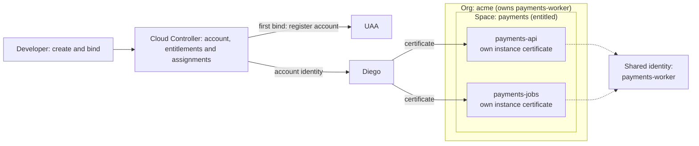
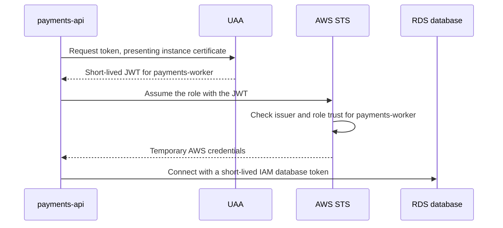
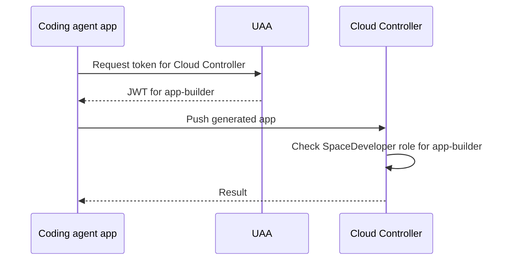

# Meta
[meta]: #meta
- Name: Service Accounts for Cloud Foundry Workload Identity
- Start Date: 2026-10-06
- Author(s): @rkoster
- Status: Draft
- RFC Pull Request: [community#1645](https://github.com/cloudfoundry/community/pull/1645)
- Related RFCs: [RFC 0055: Identity-Aware Routing for GoRouter](rfc-0055-identity-aware-routing-for-gorouter.md)
- Affected Component(s): Cloud Controller, BBS, Diego, UAA, CF CLI, service brokers; later GoRouter

## Summary

Cloud Foundry apps need an identity that external services can trust, without
being handed a secret. This RFC proposes **service accounts**: named identities
owned by an org and entitled to the spaces whose apps may use them.

Apps prove their account with the certificate Cloud Foundry already gives every
instance, and exchange it for short-lived tokens from UAA. The main use is
**workload identity federation (WIF)** with cloud services, whether owned by the
team itself or provisioned by a service broker. The same identity also lets
coding agents call the Cloud Foundry API and authorizes app-to-app routes.

**One account, multiple apps, no shared secrets, explicit permissions.**

## Problem

A payments team runs two apps: an API that stores invoices in a PostgreSQL
database on Amazon RDS, and a worker that processes them. Today both apps get a
long-lived database password, from a service binding or a user-provided service.
Credentials like this leak, are hard to rotate, and are shared by everything that
can read the binding.

Cloud providers offer **WIF** instead: the app presents a signed token from a
trusted issuer and receives short-lived credentials. UAA can issue such tokens.
What is missing is a suitable **identity** to put in them. Platform teams have
repeatedly asked for one that is:

| Requirement | Why it matters |
| --- | --- |
| **Shared** by a chosen set of apps | The API and worker are one workload; blue/green apps come and go |
| **Stable** across app replacement, renames and space recreation | External policies should not change on every deployment or reorganization |
| **Human-readable** | For sensitive data, teams own their cloud accounts and write and review trust policies themselves |
| **Known in advance** | For disaster recovery, external roles exist *before* the platform and apps |
| **Secretless** | Nothing long-lived to store, leak or rotate |
| **Explicitly authorized** | Having an identity must not grant access by itself, and only chosen spaces may use it |

Instance, app, org and space identities each fail at least one of these; see
[Alternatives considered](#alternatives-considered).

## Developer experience

### 1. Create an account and assign it to apps

```sh
cf target -o acme -s payments
cf create-service-account payments-worker
cf bind-service-account payments-api payments-worker
cf bind-service-account payments-jobs payments-worker
cf restart payments-api
cf restart payments-jobs
```

The account belongs to the `acme` org and is **entitled** to the `payments`
space, where it was created. Only apps in entitled spaces can use it. An app has
at most one account; many apps can share one. Changes apply on restart.
Assigning an account grants no permissions: an account answers **"who am I?"**,
grants and roles answer **"what may I do?"**



*Both apps carry the same account identity, each in its own platform-issued,
automatically rotated certificate. Nothing is shared between them.*

### 2. Use the account in another space

When the same workload spans spaces, the account is entitled to another space
explicitly, by an Org Manager or by a Space Developer of both spaces:

```sh
cf entitle-service-account payments-worker payments-batch
```

Every additional space is a deliberate decision, and `cf service-account
payments-worker` lists all entitled spaces. Entitlements never cross orgs.

If a space is deleted, only its entitlement is removed; the account stays in the
org. A recreated space can be entitled again, and external roles keep working.

### 3. Access a cloud service

The app needs a role in the cloud account that trusts its service account. Who
creates that role depends on who owns the resource; the app works the same way.

#### Team-owned resources

For the most sensitive data, shared brokers are often not allowed: following
least privilege, databases live in cloud accounts owned by the team, which
writes its own trust policies, usually as infrastructure as code. The team
creates an IAM role that trusts exactly one identity:

```json
{
  "Effect": "Allow",
  "Principal": { "Federated": "arn:aws:iam::123456789012:oidc-provider/uaa.example.org/oauth/token" },
  "Action": "sts:AssumeRoleWithWebIdentity",
  "Condition": {
    "StringEquals": {
      "uaa.example.org/oauth/token:sub": "cf:service-account:payments-worker",
      "uaa.example.org/oauth/token:aud": "https://sts.amazonaws.com"
    }
  }
}
```

Every value is readable and known before any CF app, space or org exists, so the
policy can be reviewed, versioned and applied in advance, including for a
recovery foundation. The team passes the non-secret connection details and role
to its apps, for example through a user-provided service:

```sh
cf create-user-provided-service payments-db -p '{"host": "payments.abc123.eu-west-1.rds.amazonaws.com", "role_arn": "arn:aws:iam::123456789012:role/cf-payments-worker"}'
cf bind-service payments-api payments-db
```

#### Broker-managed services

Where a broker is acceptable, it automates the same setup. `cf bind-service`
works as today: if the app has an account, Cloud Controller tells the broker
which account is binding. An RDS broker then creates a database user and an IAM
role trusting only `payments-worker`, and returns connection details and the
role: **no password** ([example](#b-example-rds-binding-and-operator-setup)).
Brokers without support keep today's behavior.

#### At runtime



*The certificate is only used to get the token. Google Cloud and Azure follow the
same pattern.*

- **Assign the account before binding brokered services.** Existing bindings keep
  their credentials; rebind to switch.
- **Access belongs to the account.** A role trusting `payments-worker` applies to
  every app using the account, in every entitled space. The CLI says so when
  binding and when entitling.

### 4. Let a coding agent use the Cloud Foundry API

```sh
cf set-space-role cf:service-account:app-builder acme generated-apps SpaceDeveloper --client
```



*Cloud Controller roles, external grants and entitlements are independent: an
entitlement decides which apps may **use** the account, a role decides what the
account may **do**.*

### 5. Authorize app-to-app routes

```sh
cf add-route-policy apps.identity --hostname invoices --source-service-account payments-worker
```

Apps using `payments-worker` can now call `invoices`. GoRouter checks the
caller's certificate; no token is involved. Existing route policies and domain
restrictions still apply.

### 6. Manage the account

| Intent | Command |
| --- | --- |
| List accounts entitled to the targeted space | `cf service-accounts` |
| List all accounts in the org, including unentitled ones (Org Managers) | `cf service-accounts --org` |
| Show an account and its entitled spaces | `cf service-account payments-worker` |
| Entitle or unentitle a space | `cf entitle-service-account` / `cf unentitle-service-account payments-worker SPACE` |
| Remove an app's account | `cf unbind-service-account payments-api` (then restart) |
| Stop or resume new tokens, e.g. after a compromise | `cf disable-service-account` / `cf enable-service-account payments-worker` |
| Delete | `cf delete-service-account payments-worker` |
| Recover a deleted name (platform admin) | `cf create-service-account payments-worker --reuse-name` |

## Identity model

| Term | Meaning for `payments-worker` |
| --- | --- |
| **Service account** | Owned by one org; used by apps in the spaces it is entitled to |
| **Entitlement** | Permission for apps in one space of that org to use the account |
| **Account name** | `payments-worker`: chosen by the team, immutable, unique in the foundation |
| **Token subject** (and UAA client ID) | `cf:service-account:payments-worker` |
| **Certificate SAN** | `payments-worker.svc.identity`, added by Diego to each instance certificate |
| **Route policy source** | `cf:svc:payments-worker` |

- Names are lowercase [RFC 1123 hostname labels][names] of 3–63 characters.
- The identity does not depend on the org, the spaces or their names. Moving a
  workload between spaces of the org, or recreating a space, keeps the subject.
- External trust is always the pair **(UAA issuer, subject)**. A recovery
  foundation with a new issuer must be trusted explicitly.
- Deleted names stay reserved, so a new account cannot silently inherit old
  external grants.
- The SAN is an identifier only; it creates no DNS record or route.

## Lifecycle and security

| Action | Running apps | New tokens | Existing tokens and certificates |
| --- | --- | --- | --- |
| Bind / unbind | Unchanged until restart | Follow the running identity | Unchanged |
| Restart | Pick up the current assignment | Use the new identity | Valid until expiry |
| Entitle a space | Its apps may now be bound | — | — |
| Unentitle a space | Not allowed while apps there use it | — | — |
| Disable | Keep running, assignments, entitlements and roles | Refused, in every entitled space | Valid until expiry |
| Delete | Not allowed while apps use it | Refused | Valid until expiry |
| Space deletion | Apps deleted; entitlement removed; **account kept** | Refused for those apps | Valid until expiry |
| Org deletion | Accounts deleted, like service instances | Refused | Valid until expiry |

New tasks use the current assignment; staging never receives the account. If
org cleanup fails, the org is kept and deletion can be retried. An account with
no entitled spaces, for example after its last space was deleted, is kept and
remains visible to Org Managers, who can entitle a space again or delete it. To
avoid such leftovers, Space Developers can delete an account they no longer
need before deleting its last space.

> **Nothing here is instant revocation.** To withdraw access immediately, remove
> the external grant, Cloud Controller role or route policy.

**Incident response.** If an instance key leaks, the attacker can request new
tokens until that certificate expires (24 hours by default in Diego), because
instance certificates cannot be revoked. Disabling the account stops UAA from
issuing new tokens for it in one step, however many external grants exist. It
does not end route access or cloud credentials already exchanged; remove the
relevant grants and end provider sessions for those.

**Tokens** are bearer JWTs, valid for at most five minutes and never past the
certificate used to obtain them. Each is requested for one audience: Cloud
Controller or an operator-configured federation endpoint. They record the
requesting instance, app, space and org GUIDs for audit; authorization uses
issuer and subject.

**Tokens are not bound to the certificate.** [RFC 8705][mtls] separates using a
certificate to authenticate the token request from binding the token to it with
a `cnf` claim. AWS, Azure and Google Cloud WIF accept the token as a bearer
assertion and do not verify proof of possession, so binding would add nothing.
UAA already supports it per client, so it can be enabled later, through bound
tokens or DPoP ([RFC 9449][dpop]), once providers support it.

## Permissions and limits

No new roles are needed. Org Managers govern all accounts in their org; Space
Developers manage the accounts entitled to their spaces, much like service
instances.

| Action or limit | Rule |
| --- | --- |
| Create an account (entitled to the targeted space) | Space Developer or platform admin, like service instances |
| Entitle another space | Org Manager or platform admin; or a Space Developer of an already entitled space who is also Space Developer of the new space |
| Unentitle a space | Org Manager or platform admin; or a Space Developer of that space, unless it is the account's last entitlement (delete the account instead) |
| Disable, enable, delete | Org Manager or platform admin; or a Space Developer of any entitled space |
| Assign to an app | Anyone who can modify the app, in an entitled space |
| See an account | Members of entitled spaces; Org Managers see all accounts in the org |
| Grant Cloud Controller roles to an account | Existing role managers |
| Reuse a deleted name | Platform admin only, audited |
| Org quota | New `service_accounts.total_service_accounts`; counts existing accounts, not deleted names |
| Creation budget | Optional foundation-wide limit on creations per user or client per rolling seven days, or unlimited; admins exempt; deletion does not refund it |

The creation budget prevents name hoarding on public platforms, since deleted
names stay reserved.

## Alternatives considered

- **Space-owned accounts.** Simple, but the account and its external identity
  disappear with the space, and every workload that spans spaces needs a separate
  sharing mechanism. Org ownership with explicit entitlements covers both, while
  an account created in a space still starts with access from that space only.
- **Global, admin-owned accounts entitled to orgs** (like isolation segments).
  Useful for platform-wide identities, but makes every account an admin task.
  Can be added later on top of the same model.
- **A new service type** (like route services or volume services). Would reuse
  binding UX, but needs special rules for one identity per app, ordering with other
  bindings, and reserved names. A dedicated resource is simpler.
- **App labels.** A reasonable assignment UX, but labels are freely editable
  metadata. Claiming an identity with existing grants must be authorized, and
  roles, grants, entitlements, disable and delete need a lifecycle beyond one app. A label UX
  could be layered on top.
- **GUID-based identity** (e.g. a SPIFFE ID with the space GUID). Valid, but not
  readable, not known in advance, and changes when the space is recreated.
- **Org and space names.** Readable, but CF names allow up to 255 characters with
  punctuation and Unicode, which DNS and SPIFFE cannot represent without lossy
  encoding, and renames change them. Hashing loses readability.
- **Existing app identity.** Changes when an app is recreated, and cannot cover a
  group of apps.
- **Per-app client secrets.** Reintroduce the secrets this proposal removes.

The account name is readable, chosen in advance and independent of mutable names
and generated IDs. It could be expressed as a SPIFFE ID later; the decision here
is the identity model, not the encoding.

## Status and next steps

**UAA certificate-based client authentication is merged in [UAA #4109][uaa]**
(superseding #4076), including the opt-in
certificate binding policy and named trust bundles, validated in a CF lab.

Drafts in [Cloud Controller][capi], [capi-release][release], [BBS][bbs],
[Diego][diego] and the [CLI][cli] demonstrate shared identity, explicit roles,
disable/enable, unbind/restart, the creation budget and clients referencing a UAA
trust bundle, using an earlier space-owned model. Org ownership with entitlements,
entitlement permissions, creation permissions, attribution claims,
org quotas, name reuse and upgrade compatibility remain. BBS, Diego and UAA are
unaffected by the ownership change.

The next step is community review and approval of the identity model and
developer experience.

## Appendix: implementation notes

### A. Open Service Broker API

Cloud Controller adds the account to the Cloud Foundry `context` of a bind
request, only when the app has a ready account (never for service keys):

```json
{
  "context": {
    "platform": "cloudfoundry",
    "service_account": {
      "issuer": "https://uaa.example.org/oauth/token",
      "subject": "cf:service-account:payments-worker"
    }
  }
}
```

This extends the CF platform profile, not core OSBAPI: no plan capability or
version negotiation. The broker decides how to use it, may require it, and keeps
an account's grant until its last binding is removed. The originating-identity
header still identifies the user, not the account. Reassigning an app requires
removing its identity-based bindings first.

### B. Example RDS binding and operator setup

Binding credentials returned by an RDS broker:

```json
{
  "host": "payments.abc123.eu-west-1.rds.amazonaws.com",
  "port": 5432,
  "database": "payments",
  "username": "payments_worker",
  "authentication": {
    "type": "aws-web-identity",
    "role_arn": "arn:aws:iam::123456789012:role/cf-payments-worker",
    "audience": "https://sts.amazonaws.com",
    "region": "eu-west-1"
  }
}
```

Platform operators configure once, at deploy time: UAA reachable as an OIDC
issuer, a named UAA trust bundle holding Diego's instance identity CA, the list of
allowed token audiences, and, where brokers are used, permission for them to
manage their grants. Whoever owns a cloud account registers UAA as a trusted
issuer there (AWS IAM OIDC provider, Google Cloud workload identity pool, Azure
federated credentials): the platform team for broker accounts, application teams
for their own accounts.

The app-facing `service_account_token_endpoint` must support **mTLS**, not just
HTTPS. Use direct UAA TLS (for example,
`https://uaa.service.cf.internal:8443/oauth/mtls/token`), TLS passthrough, or UAA's
trusted-proxy mode with an authenticated proxy forwarding the client certificate.
Ordinary L7 TLS termination alone is insufficient. Apps must be able to reach
the endpoint and trust its server certificate.

### C. UAA client registration

Cloud Controller registers one secretless client per account, using settings
from [UAA #4109][uaa] and the proposed named resource-policy reference in
[UAA #4125][resource-policy]:

```json
{
  "client_id": "cf:service-account:payments-worker",
  "authorized_grant_types": ["client_credentials"],
  "authorities": ["cloud_controller.read", "cloud_controller.write"],
  "access_token_validity": 300,
  "tls-client-auth-ca-ref": "diego-instance-identity",
  "tls_client_auth_san_dns": "payments-worker.svc.identity",
  "tls_client_certificate_bound_access_tokens": false,
  "tls-client-auth-allowed-resources-ref": "cf-workload-federation",
  "tls-client-auth-claim-mappings": [
    { "field": "subject_cn", "claim": "cf_instance_guid" },
    { "field": "subject_ou", "pattern": "^app:(.+)$", "claim": "app_guid" },
    { "field": "subject_ou", "pattern": "^space:(.+)$", "claim": "space_guid" },
    { "field": "subject_ou", "pattern": "^organization:(.+)$", "claim": "org_guid" }
  ],
  "tls-client-auth-required-claims": { "org_guid": "<owning-org-guid>" }
}
```

For federation, the app requests one allowed audience using RFC 8707:

```text
POST /oauth/mtls/token
Content-Type: application/x-www-form-urlencoded

grant_type=client_credentials&client_id=cf%3Aservice-account%3Apayments-worker&resource=https%3A%2F%2Fsts.amazonaws.com
```

UAA checks the allowed-resource list and sets `aud` to the requested value.
Provider-specific checks, including AWS's handling of `azp`, are described in
[appendix F](#f-federation-audience-reference).

Operators define the referenced policy in UAA, as proposed in
[UAA #4125][resource-policy] (not implemented yet):

```yaml
uaa:
  mtls:
    resource_policies:
      cf-workload-federation:
        allowed_resources:
          - https://sts.amazonaws.com
          - api://AzureADTokenExchange
```

UAA resolves the policy in the client's identity zone during issuance. Changing
the policy affects subsequent token requests without updating client registrations.
Unknown or removed references fail closed; inline lists and references are mutually
exclusive. Removing an audience does not revoke already-issued tokens or exchanged
credentials. CAPI and application libraries also need federation integration.

Only certificates issued by a CA in the `diego-instance-identity` trust bundle,
with this account's SAN and from the owning org, are accepted. Entitlements are
enforced by Cloud Controller and Diego, which only add the SAN to certificates of
apps in entitled spaces; the registration does not change when entitlements do.
Tokens are plain bearer tokens for Cloud Controller or the operator's federation
audiences, and carry the instance, app, space and org GUIDs for audit.
`authorities` only allow Cloud Controller tokens; actual access still depends on
explicit roles. Developers cannot change any of these values.

### D. Platform components

- **Cloud Controller** stores accounts, entitlements and assignments, registers
  the UAA client on first bind and creates a roleless principal for role grants.
- **BBS and Diego** add the account SAN to instance certificates; apps discover
  their client ID and token endpoint through non-secret `VCAP_SERVICE_ACCOUNT`.
- **GoRouter** matches route policies against the SAN.
- Staging never receives an account. Components that do not support accounts
  fail closed during upgrades.

### E. CA rotation

External providers trust UAA's signing keys, not Diego's CA, and are unaffected.
Account clients never contain the CA: they reference an operator-defined UAA trust
bundle by name ([UAA #4109][uaa]). When Diego's root CA rotates, the operator
updates that bundle in UAA's configuration, first to old and new CA, then to the
new CA only. No account client changes, and Cloud Controller is not involved.

### F. Federation audience reference

Federation audiences are configured identifiers, not necessarily API endpoints or
individual roles. Providers enforce them differently:

| Provider | Documented audience checks | Configuration consequence |
| --- | --- | --- |
| [AWS STS][aws-audience] | The IAM OIDC provider's audience list is checked against `azp` when present, otherwise `aud`. In role trust policies, `:aud` follows that same mapping; `:oaud` maps to the original JWT `aud` ([condition keys][aws-claims]). | Custom-provider audiences are configurable; `sts.amazonaws.com` is a common convention. `https://sts.amazonaws.com` fits RFC 8707's absolute-URI requirement, but changing UAA's `aud` alone is insufficient while `azp` remains the client ID. |
| [Google Cloud WIF][gcp-audience] | Rejects tokens whose `aud` does not match the provider's `allowedAudiences`. With no explicit list, accepts the provider's canonical resource name, with or without the HTTPS prefix. | A custom audience can be configured. The STS request's separate `audience` parameter still identifies the workload identity pool provider ([exchange API][gcp-exchange]). |
| [Microsoft Entra WIF][azure-audience] | The federated identity credential's issuer, subject and audience must match the token case-sensitively. `api://AzureADTokenExchange` is the recommended audience ([credential schema][azure-credential]). | This audience identifies the exchange, not the database or other API. The token request separately selects the Entra application/managed identity and the desired resource scopes. |

These are configuration choices, not permission grants or proof of possession.
The provider also validates the issuer, signature and lifetime and applies its
authorization rules. The AWS examples above illustrate the desired integration;
UAA currently emits `azp` equal to its client ID, so that token profile needs
alignment before the shared-audience AWS flow is considered validated.

[aws-audience]: https://docs.aws.amazon.com/IAM/latest/UserGuide/id_roles_providers_create_oidc.html#manage-oidc-provider-console
[aws-claims]: https://docs.aws.amazon.com/IAM/latest/UserGuide/reference_policies_iam-condition-keys.html#condition-keys-wif
[gcp-audience]: https://cloud.google.com/iam/docs/reference/rest/v1/projects.locations.workloadIdentityPools.providers#Oidc
[gcp-exchange]: https://cloud.google.com/iam/docs/reference/sts/rest/v1/TopLevel/token
[azure-audience]: https://learn.microsoft.com/en-us/entra/workload-id/workload-identity-federation#how-it-works
[azure-credential]: https://learn.microsoft.com/en-us/graph/api/resources/federatedidentitycredential?view=graph-rest-1.0
[mtls]: https://www.rfc-editor.org/rfc/rfc8705.html
[dpop]: https://www.rfc-editor.org/rfc/rfc9449.html
[names]: https://www.rfc-editor.org/rfc/rfc1123.html#section-2.1
[capi]: https://github.com/cloudfoundry/cloud_controller_ng/pull/5520
[release]: https://github.com/cloudfoundry/capi-release/pull/702
[bbs]: https://github.com/cloudfoundry/bbs/pull/168
[diego]: https://github.com/cloudfoundry/diego-release/pull/1216
[cli]: https://github.com/cloudfoundry/cli/pull/3875
[uaa]: https://github.com/cloudfoundry/uaa/pull/4109
[resource-policy]: https://github.com/cloudfoundry/uaa/issues/4125
