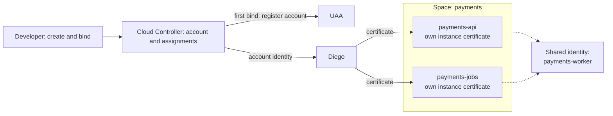
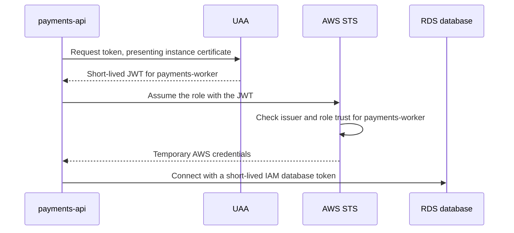
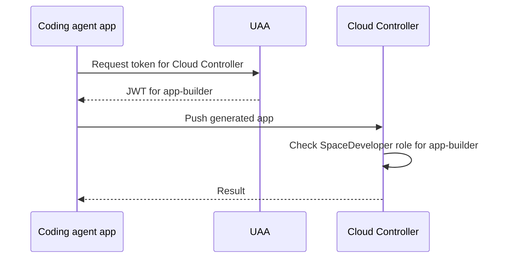

# Meta
[meta]: #meta
- Name: Service Accounts for Cloud Foundry Workload Identity
- Start Date: 2026-10-06
- Author(s): @rkoster
- Status: Draft
- RFC Pull Request: [community#1645](https://github.com/cloudfoundry/community/pull/1645)
- Related RFCs: [RFC 0055: Identity-Aware Routing for GoRouter](rfc-0055-identity-aware-routing-for-gorouter.md)
- Affected Component(s): Cloud Controller, BBS, Diego, UAA, CF CLI, service brokers; later GoRouter

## Summary

Cloud Foundry apps need an identity that external services can trust, without
being handed a secret. This RFC proposes **service accounts**: named identities
that a team creates in a space and assigns to one or more apps.

Apps prove their account with the certificate Cloud Foundry already gives every
instance, and exchange it for short-lived tokens from UAA. The main use is
**workload identity federation (WIF)** with cloud services, whether owned by the
team itself or provisioned by a service broker. The same identity also lets
coding agents call the Cloud Foundry API and authorizes app-to-app routes.

**One account, multiple apps, no shared secrets, explicit permissions.**

## Problem

A payments team runs two apps: an API that stores invoices in a PostgreSQL
database on Amazon RDS, and a worker that processes them. Today both apps get a
long-lived database password, from a service binding or a user-provided service.
Credentials like this leak, are hard to rotate, and are shared by everything that
can read the binding.

Cloud providers offer **WIF** instead: the app presents a signed token from a
trusted issuer and receives short-lived credentials. UAA can issue such tokens.
What is missing is a suitable **identity** to put in them. Platform teams have
repeatedly asked for one that is:

| Requirement | Why it matters |
| --- | --- |
| **Shared** by a chosen set of apps | The API and worker are one workload; blue/green apps come and go |
| **Stable** across app replacement and renames | External policies should not change on every deployment |
| **Human-readable** | For sensitive data, teams own their cloud accounts and write and review trust policies themselves |
| **Known in advance** | For disaster recovery, external roles exist *before* the platform and apps |
| **Secretless** | Nothing long-lived to store, leak or rotate |
| **Explicitly authorized** | Having an identity must not grant access by itself |

Instance, app, org and space identities each fail at least one of these; see
[Alternatives considered](#alternatives-considered).

## Developer experience

### 1. Create an account and assign it to apps

```sh
cf target -o acme -s payments
cf create-service-account payments-worker
cf bind-service-account payments-api payments-worker
cf bind-service-account payments-jobs payments-worker
cf restart payments-api
cf restart payments-jobs
```

An app has at most one account; many apps in the same space can share one. Apps
in other spaces cannot use it. Changes apply on restart. Assigning an account
grants no permissions: an account answers **"who am I?"**, grants and roles
answer **"what may I do?"**



*Both apps carry the same account identity, each in its own platform-issued,
automatically rotated certificate. Nothing is shared between them.*

### 2. Access a cloud service

The app needs a role in the cloud account that trusts its service account. Who
creates that role depends on who owns the resource; the app works the same way.

#### Team-owned resources

For the most sensitive data, shared brokers are often not allowed: following
least privilege, databases live in cloud accounts owned by the team, which
writes its own trust policies, usually as infrastructure as code. The team
creates an IAM role that trusts exactly one identity:

```json
{
  "Effect": "Allow",
  "Principal": { "Federated": "arn:aws:iam::123456789012:oidc-provider/uaa.example.org/oauth/token" },
  "Action": "sts:AssumeRoleWithWebIdentity",
  "Condition": {
    "StringEquals": {
      "uaa.example.org/oauth/token:sub": "cf:service-account:payments-worker",
      "uaa.example.org/oauth/token:aud": "https://sts.amazonaws.com"
    }
  }
}
```

Every value is readable and known before any CF app or space exists, so the
policy can be reviewed, versioned and applied in advance, including for a
recovery foundation. The team passes the non-secret connection details and role
to its apps, for example through a user-provided service:

```sh
cf create-user-provided-service payments-db -p '{"host": "payments.abc123.eu-west-1.rds.amazonaws.com", "role_arn": "arn:aws:iam::123456789012:role/cf-payments-worker"}'
cf bind-service payments-api payments-db
```

#### Broker-managed services

Where a broker is acceptable, it automates the same setup. `cf bind-service`
works as today: if the app has an account, Cloud Controller tells the broker
which account is binding. An RDS broker then creates a database user and an IAM
role trusting only `payments-worker`, and returns connection details and the
role: **no password** ([example](#b-example-rds-binding-and-operator-setup)).
Brokers without support keep today's behavior.

#### At runtime



*The certificate is only used to get the token. Google Cloud and Azure follow the
same pattern.*

- **Assign the account before binding brokered services.** Existing bindings keep
  their credentials; rebind to switch.
- **Access belongs to the account.** A role trusting `payments-worker` applies to
  every app sharing the account. The CLI says so when binding.

### 3. Let a coding agent use the Cloud Foundry API

```sh
cf set-space-role cf:service-account:app-builder acme generated-apps SpaceDeveloper --client
```



*Cloud Controller roles and external grants are independent of each other.*

### 4. Authorize app-to-app routes

```sh
cf add-route-policy apps.identity --hostname invoices --source-service-account payments-worker
```

Both payments apps can now call `invoices`. GoRouter checks the caller's
certificate; no token is involved. Existing route policies and domain
restrictions still apply.

### 5. Manage the account

| Intent | Command |
| --- | --- |
| List or show | `cf service-accounts`, `cf service-account payments-worker` |
| Remove an app's account | `cf unbind-service-account payments-api` (then restart) |
| Stop or resume new tokens | `cf disable-service-account` / `cf enable-service-account payments-worker` |
| Delete | `cf delete-service-account payments-worker` |
| Recover a deleted name (platform admin) | `cf create-service-account payments-worker --reuse-name` |

## Identity model

| Term | Meaning for `payments-worker` |
| --- | --- |
| **Service account** | Owned by one space; assigned to zero or more apps there |
| **Account name** | `payments-worker`: chosen by the team, immutable, unique in the foundation |
| **Token subject** (and UAA client ID) | `cf:service-account:payments-worker` |
| **Certificate SAN** | `payments-worker.svc.identity`, added by Diego to each instance certificate |
| **Route policy source** | `cf:svc:payments-worker` |

- Names are lowercase [RFC 1123 hostname labels][names] of 3–63 characters.
- External trust is always the pair **(UAA issuer, subject)**. A recovery
  foundation with a new issuer must be trusted explicitly.
- Deleted names stay reserved, so a new account cannot silently inherit old
  external grants.
- The SAN is an identifier only; it creates no DNS record or route.

## Lifecycle and security

| Action | Running apps | New tokens | Existing tokens and certificates |
| --- | --- | --- | --- |
| Bind / unbind | Unchanged until restart | Follow the running identity | Unchanged |
| Restart | Pick up the current assignment | Use the new identity | Valid until expiry |
| Disable | Keep running, assignments and roles | Refused | Valid until expiry |
| Delete | Not allowed while apps use it | Refused | Valid until expiry |
| Space or org deletion | Deleted, like service instances | Refused | Valid until expiry |

New tasks use the current assignment; staging never receives the account. If
space or org cleanup fails, the space or org is kept and can be retried.

> **Nothing here is instant revocation.** To withdraw access immediately, remove
> the external grant, Cloud Controller role or route policy.

**Tokens** are bearer JWTs, valid for at most five minutes and never past the
certificate used to obtain them. Each is requested for one audience: Cloud
Controller or an operator-configured federation endpoint. They record the
requesting instance, app, space and org GUIDs for audit; authorization uses
issuer and subject.

**Tokens are not bound to the certificate.** [RFC 8705][mtls] separates using a
certificate to authenticate the token request from binding the token to it with
a `cnf` claim. AWS, Azure and Google Cloud WIF accept the token as a bearer
assertion and do not verify proof of possession, so binding would add nothing.
UAA already supports it per client, so it can be enabled later, through bound
tokens or DPoP ([RFC 9449][dpop]), once providers support it.

## Permissions and limits

| Action or limit | Rule |
| --- | --- |
| Create an account | Space Developer or platform admin, like service instances |
| Disable, enable, delete | Space Manager or platform admin |
| Assign to an app | Anyone who can modify the app, within the owning space |
| Grant Cloud Controller roles | Existing role managers |
| Reuse a deleted name | Platform admin only, audited |
| Space quota | New `service_accounts.total_service_accounts`; counts existing accounts, not deleted names |
| Creation budget | Optional foundation-wide limit on creations per user or client per rolling seven days, or unlimited; admins exempt; deletion does not refund it |

The creation budget prevents name hoarding on public platforms, since deleted
names stay reserved.

## Alternatives considered

- **App labels.** A reasonable assignment UX, but labels are freely editable
  metadata. Claiming an identity with existing grants must be authorized, and
  roles, grants, disable and delete need a lifecycle beyond one app. A label UX
  could be layered on top.
- **GUID-based identity** (e.g. a SPIFFE ID with the space GUID). Valid, but not
  readable, not known in advance, and changes when the space is recreated.
- **Org and space names.** Readable, but CF names allow up to 255 characters with
  punctuation and Unicode, which DNS and SPIFFE cannot represent without lossy
  encoding, and renames change them. Hashing loses readability.
- **Existing app identity.** Changes when an app is recreated, and cannot cover a
  group of apps.
- **Per-app client secrets.** Reintroduce the secrets this proposal removes.

The account name is readable, chosen in advance and independent of mutable names
and generated IDs. It could be expressed as a SPIFFE ID later; the decision here
is the identity model, not the encoding.

## Status and next steps

**UAA certificate-based client authentication is implemented and agreed with the
UAA team, pending final review in [UAA #4076][uaa]**, including the opt-in
certificate binding policy, validated in a CF lab.

Drafts in [Cloud Controller][capi], [capi-release][release], [BBS][bbs],
[Diego][diego] and the [CLI][cli] demonstrate shared identity, explicit roles,
disable/enable, unbind/restart, the creation budget and cascading space deletion.
Creation permissions, attribution claims, CA rotation, space quotas, name reuse
and upgrade compatibility remain.

The next step is community review and approval of the identity model and
developer experience.

## Appendix: implementation notes

### A. Open Service Broker API

Cloud Controller adds the account to the Cloud Foundry `context` of a bind
request, only when the app has a ready account (never for service keys):

```json
{
  "context": {
    "platform": "cloudfoundry",
    "service_account": {
      "issuer": "https://uaa.example.org/oauth/token",
      "subject": "cf:service-account:payments-worker"
    }
  }
}
```

This extends the CF platform profile, not core OSBAPI: no plan capability or
version negotiation. The broker decides how to use it, may require it, and keeps
an account's grant until its last binding is removed. The originating-identity
header still identifies the user, not the account. Reassigning an app requires
removing its identity-based bindings first.

### B. Example RDS binding and operator setup

Binding credentials returned by an RDS broker:

```json
{
  "host": "payments.abc123.eu-west-1.rds.amazonaws.com",
  "port": 5432,
  "database": "payments",
  "username": "payments_worker",
  "authentication": {
    "type": "aws-web-identity",
    "role_arn": "arn:aws:iam::123456789012:role/cf-payments-worker",
    "audience": "https://sts.amazonaws.com",
    "region": "eu-west-1"
  }
}
```

Platform operators configure once, at deploy time: UAA reachable as an OIDC
issuer, the list of allowed token audiences, and, where brokers are used,
permission for them to manage their grants. Whoever owns a cloud account
registers UAA as a trusted issuer there (AWS IAM OIDC provider, Google Cloud
workload identity pool, Azure federated credentials): the platform team for
broker accounts, application teams for their own accounts.

### C. UAA client registration

Cloud Controller registers one secretless client per account, using settings
from [UAA #4076][uaa]:

```json
{
  "client_id": "cf:service-account:payments-worker",
  "authorized_grant_types": ["client_credentials"],
  "authorities": ["cloud_controller.read", "cloud_controller.write"],
  "access_token_validity": 300,
  "tls-client-auth-ca": "<Diego instance identity CA>",
  "tls_client_auth_san_dns": "payments-worker.svc.identity",
  "tls_client_certificate_bound_access_tokens": false,
  "tls-client-auth-allowed-resources": ["https://sts.amazonaws.com"],
  "tls-client-auth-claim-mappings": [
    { "field": "subject_cn", "claim": "cf_instance_guid" },
    { "field": "subject_ou", "pattern": "^app:(.+)$", "claim": "app_guid" },
    { "field": "subject_ou", "pattern": "^space:(.+)$", "claim": "space_guid" },
    { "field": "subject_ou", "pattern": "^organization:(.+)$", "claim": "org_guid" }
  ],
  "tls-client-auth-required-claims": { "space_guid": "<owning-space-guid>" }
}
```

Only Diego-issued certificates with this account's SAN, from the owning space,
are accepted. Tokens are plain bearer tokens for Cloud Controller or the
operator's federation audiences, and carry the instance, app, space and org GUIDs
for audit. `authorities` only allow Cloud Controller tokens; actual access still
depends on explicit roles. Developers cannot change any of these values.

### D. Platform components

- **Cloud Controller** stores accounts and assignments, registers the UAA client
  on first bind and creates a roleless principal for role grants.
- **BBS and Diego** add the account SAN to instance certificates; apps discover
  their client ID and token endpoint through non-secret `VCAP_SERVICE_ACCOUNT`.
- **GoRouter** matches route policies against the SAN.
- Staging never receives an account. Components that do not support accounts
  fail closed during upgrades.

### E. CA rotation

External providers trust UAA's signing keys, not Diego's CA, and are unaffected.
When Diego's root CA rotates, UAA trusts old and new CAs during the overlap, then
the new one only. Preferably, UAA gains operator-defined **named trust bundles**
that clients reference (proposed on [UAA #4076][uaa]), making rotation a UAA
configuration change. Until then, Cloud Controller copies its configured CA
bundle into every account client and updates the clients it owns when it changes.

[mtls]: https://www.rfc-editor.org/rfc/rfc8705.html
[dpop]: https://www.rfc-editor.org/rfc/rfc9449.html
[names]: https://www.rfc-editor.org/rfc/rfc1123.html#section-2.1
[capi]: https://github.com/cloudfoundry/cloud_controller_ng/pull/5520
[release]: https://github.com/cloudfoundry/capi-release/pull/702
[bbs]: https://github.com/cloudfoundry/bbs/pull/168
[diego]: https://github.com/cloudfoundry/diego-release/pull/1216
[cli]: https://github.com/cloudfoundry/cli/pull/3875
[uaa]: https://github.com/cloudfoundry/uaa/pull/4076
